# Exploratory Data Analysis Report

## Dataset scope

This report presents the pre-cleaning profile of the full `merged_order_items` dataset in `data/interim`. Each row represents one order item, identified by `(order_id, order_item_id)`. Order, customer, product and seller attributes are repeated across the item rows where applicable.

Counts and percentages use commas as thousands separators and periods for decimals. Percentages are rounded within each table. Missing values refer to nulls (`isna()`); empty or whitespace-only strings are reported separately. Diagnostic groups may overlap.

## Contents

1. [Scope and structure](#1-scope-and-structure)
2. [Missing values and co-occurring patterns](#2-missing-values-and-co-occurring-patterns)
3. [Numeric distributions and tails](#3-numeric-distributions-and-tails)
4. [Order status, categories and geography](#4-order-status-categories-and-geography)
5. [Timestamp coverage and distributions](#5-timestamp-coverage-and-distributions)
6. [Timestamp ordering and shipping deadlines](#6-timestamp-ordering-and-shipping-deadlines)
7. [Text formats](#7-text-formats)
8. [Order composition](#8-order-composition)

## 1. Scope and structure

| Unit of observation | Count |
|---|---:|
| Item — key `(order_id, order_item_id)` | 112,650 |
| Columns in the full table | 25 |
| Orders — `order_id` | 98,666 |
| Customer records — `customer_id` | 98,666 |
| Products — `product_id` | 32,951 |
| Sellers — `seller_id` | 3,095 |

`customer_id` identifies a customer record linked to a purchase. The full table does not contain `customer_unique_id`; therefore, 98,666 is the number of customer records, not the number of unique people.

There are no exact duplicate rows, repeated item keys, missing or blank source keys, or entities with conflicting attributes across their item rows. Item numbers range from **1 to 21**, with consecutive numbering within each order.

## 2. Missing values and co-occurring patterns

### 2.1. Full-table and entity-level completeness

The full table has **5,338 missing cells**, present in **4,007 / 112,650 item rows (3.5570%)**. Nulls occur in **8 / 25 columns**. **108,643 items (96.4430%)** have no missing values among the 25 selected columns.

| Columns with nulls | Missing items per column | Missing source entities | Rate at source grain |
|---|---:|---:|---:|
| `order_approved_at` | 15 | 14 orders | 0.0142% / 98,666 orders |
| `order_delivered_carrier_date` | 1,194 | 1,009 orders | 1.0226% / 98,666 orders |
| `order_delivered_customer_date` | 2,454 | 2,190 orders | 2.2196% / 98,666 orders |
| `product_category_name` | 1,603 | 610 products | 1.8512% / 32,951 products |
| All four weight/length/height/width columns | 18 in **each** column | The same 2 products in each column | 0.0061% / 32,951 products |

The **other 17 columns have no nulls**, including all keys, price, freight, purchase time, estimated delivery date, shipping deadline and customer/seller geography. Customer and seller views have no nulls. No blank strings were found in the text columns checked.

Item counts missing from different columns cannot be summed to get the number of affected items, because an item may be missing more than one column. Order and product values repeat across item rows.

### 2.2. Core timestamp patterns at order grain

The four core timestamps are Purchase, Approved, Carrier Handoff and Customer Delivery. **2,205 / 98,666 orders (2.2348%)** are missing at least one core timestamp; **96,461 orders** have all four.

| Observed missing pattern | Orders |
|---|---:|
| Customer Delivery only | 1,182 |
| Carrier Handoff and Customer Delivery | 1,008 |
| Approved only | 14 |
| Carrier Handoff only | 1 |

Among the **1,009 orders missing Carrier Handoff**, **1,008 also lack Customer Delivery (99.9009%)**. Conversely, **1,008 / 2,190 orders missing Customer Delivery also lack Carrier Handoff (46.0274%)**. No order missing Approved also lacks Carrier Handoff or Customer Delivery in this dataset.

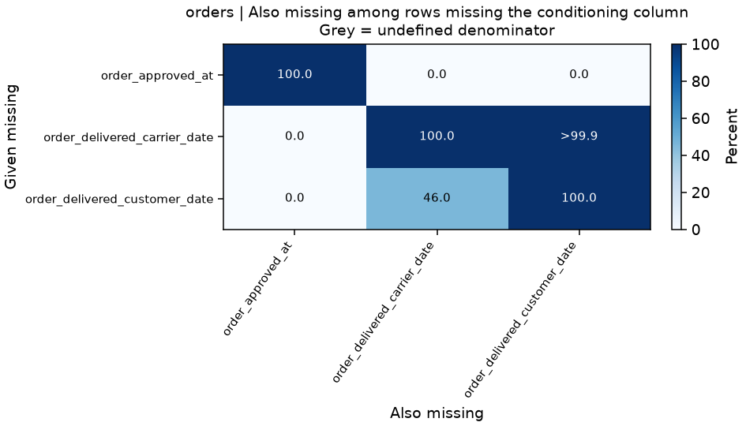

### 2.3. Timestamps by status and within delivered orders

`shipped`, `invoiced`, `processing`, `approved` and `unavailable` each have **100% of orders missing at least one core timestamp**, a total of **1,727 orders**. The `canceled` group has **455 / 461 orders (98.6985%)** missing a core timestamp. The `delivered` group has **23 / 96,478 orders (0.0238%)** missing a core timestamp.

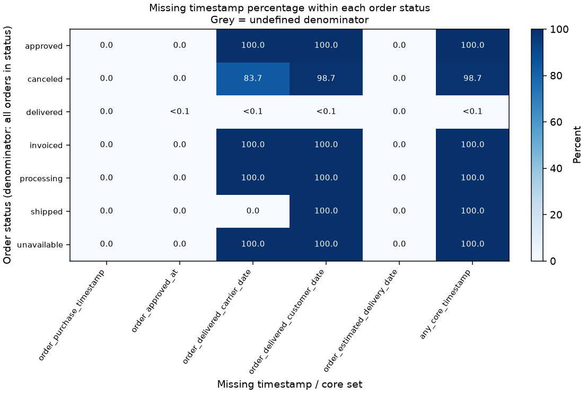

The 23 delivered orders missing a core timestamp have these patterns:

| Missing pattern | Orders |
|---|---:|
| Approved only | 14 |
| Customer Delivery only | 7 |
| Carrier Handoff only | 1 |
| Carrier Handoff and Customer Delivery | 1 |

Purchase and Estimated Delivery are present in these 23 orders and throughout the order view.

### 2.4. Missing product information

Two products are missing physical measurements; both lack **all four** weight/length/height/width values. They occur in **18 items across 16 orders**. Among these two products:

- One product also lacks category, occurring in **17 items across 15 orders**.
- The other has category `bebes`, occurring in **1 item in 1 order**.

Thus, category is missing for **1 / 2 products (50%)** among products missing physical measurements, but for **17 / 18 items (94.4444%)** at item grain. Of all **610 products missing category**, **609 still have all four physical measurements**. Products missing category occur in **1,603 items across 1,451 orders**.

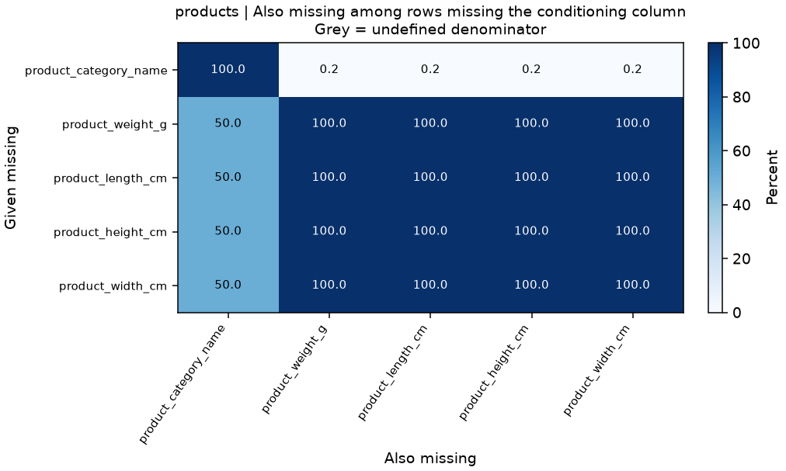

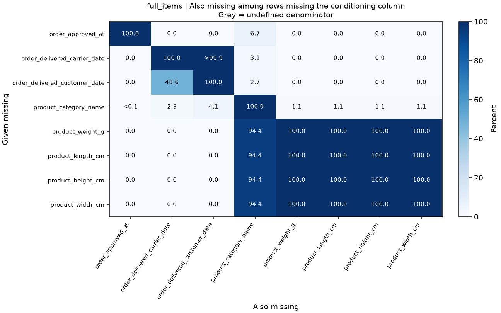

In both heatmaps, rows determine the denominator: records missing the row's field. The cells do not use all items/products as the denominator for each pair.

## 3. Numeric distributions and tails

All six numeric measurements have **0 negative values** and **0 ±infinity values** among non-null observations. Price and freight use 112,650 items; each physical measurement uses 32,949 products with finite values.

| Measurement | Unit | Min | Median | Mean | P99 | Max |
|---|---|---:|---:|---:|---:|---:|
| Price | BRL / item | 0.85 | 74.99 | 120.65 | 890.00 | 6,735.00 |
| Freight | BRL / item | 0.00 | 16.26 | 19.99 | 84.52 | 409.68 |
| Weight | g / product | 0 | 700 | 2,276.47 | 22,538 | 40,425 |
| Length | cm / product | 7 | 25 | 30.82 | 100 | 105 |
| Height | cm / product | 2 | 13 | 16.94 | 69 | 105 |
| Width | cm / product | 6 | 20 | 23.20 | 63 | 118 |

Each figure contains a full-range histogram, a P01–P99 display window and a full-range boxplot. The window only restricts the plotted range; the figure shows counts outside the window.

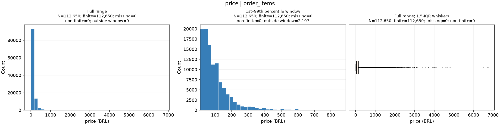

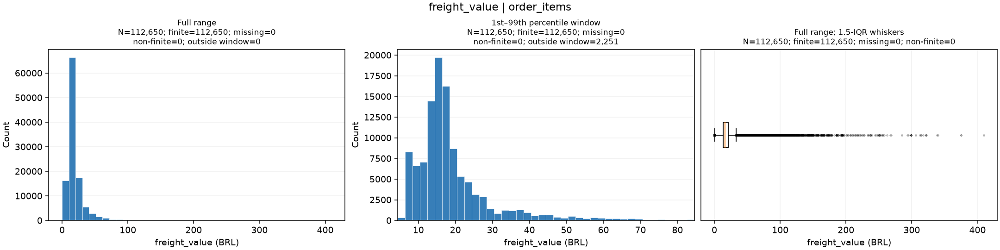

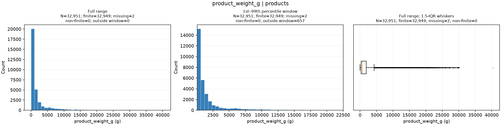

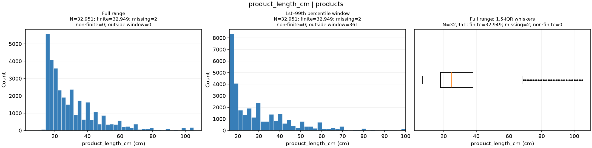

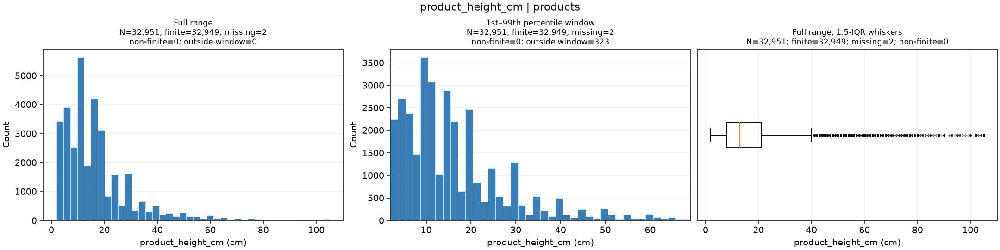

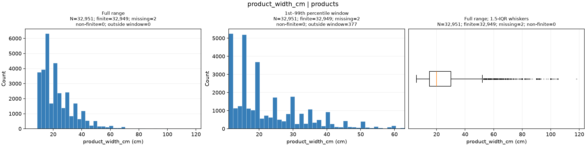

### 3.1. Zero values

Freight equals zero in **383 / 112,650 items (0.3400%)**, across **339 orders**. This includes **381 delivered items** and **2 shipped items**; the other statuses have no zero-freight items.

Weight equals zero for **4 / 32,951 products (0.0121%)**, occurring in **8 items across 6 orders**. All four have category `cama_mesa_banho` and dimensions **30 × 25 × 30 cm**, in length × height × width order. Length, height and width have no zero values.

Combining missing or nonpositive values in any physical measurement gives **6 products**, occurring in **26 items across 22 orders**. This consists of 2 products with all physical measurements missing and 4 different products with weight equal to zero.

### 3.2. Values outside the IQR limits

Limits are `Q1 − 1.5 × IQR` and `Q3 + 1.5 × IQR`, calculated on finite values. These counts describe observations beyond the statistical limits; they are not business-defined validity thresholds.

| Measurement | Lower limit | Upper limit | Outside / finite | Rate |
|---|---:|---:|---:|---:|
| Price | -102.600 | 277.400 | 8,427 / 112,650 | 7.4807% |
| Freight | 0.975 | 33.255 | 12,134 / 112,650 | 10.7714% |
| Weight | -2,100 | 4,300 | 4,551 / 32,949 | 13.8123% |
| Length | -12 | 68 | 1,380 / 32,949 | 4.1883% |
| Height | -11.5 | 40.5 | 1,892 / 32,949 | 5.7422% |
| Width | -7.5 | 52.5 | 912 / 32,949 | 2.7679% |

Freight has **521 items below** the lower limit and **11,613 items above** the upper limit. All observations outside the IQR limits for the other five measurements are above their upper limits.

Observed maxima include price **BRL 6,735** in `utilidades_domesticas`; freight **BRL 409.68** in `bebes`; weight **40,425 g** and width **118 cm** in `cama_mesa_banho`.

## 4. Order status, categories and geography

### 4.1. Order status

There are **7 statuses**. Delivered accounts for **96,478 / 98,666 orders (97.7824%)**. The other six statuses total **2,188 orders**: shipped 1,106; canceled 461; invoiced 312; processing 301; unavailable 6; approved 2. Status is neither null nor blank.

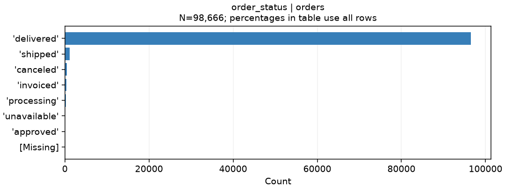

### 4.2. Product categories

There are **73 non-null categories**. The most frequent category is `cama_mesa_banho`: **3,029 / 32,951 products (9.1924%)**, followed by `esporte_lazer` (2,867) and `moveis_decoracao` (2,657). **610 products missing category** are retained as a Missing group.

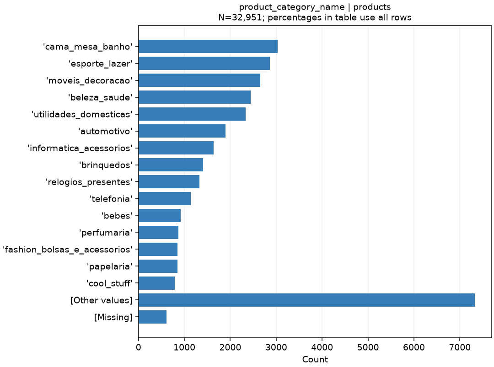

### 4.3. Customer and seller geography

Customers have **27 states**, **4,110 cities** and **14,976 distinct ZIP prefixes**. Sellers have **23 states**, **611 cities** and **2,246 distinct ZIP prefixes**. These columns have no nulls or blanks; city counts use original text values.

State SP accounts for **41,375 / 98,666 customer records (41.9344%)** and **1,849 / 3,095 sellers (59.7415%)**. The exact city string `sao paulo` occurs in **15,402 customer records** and **694 seller records**; variants with different whitespace remain separate values.

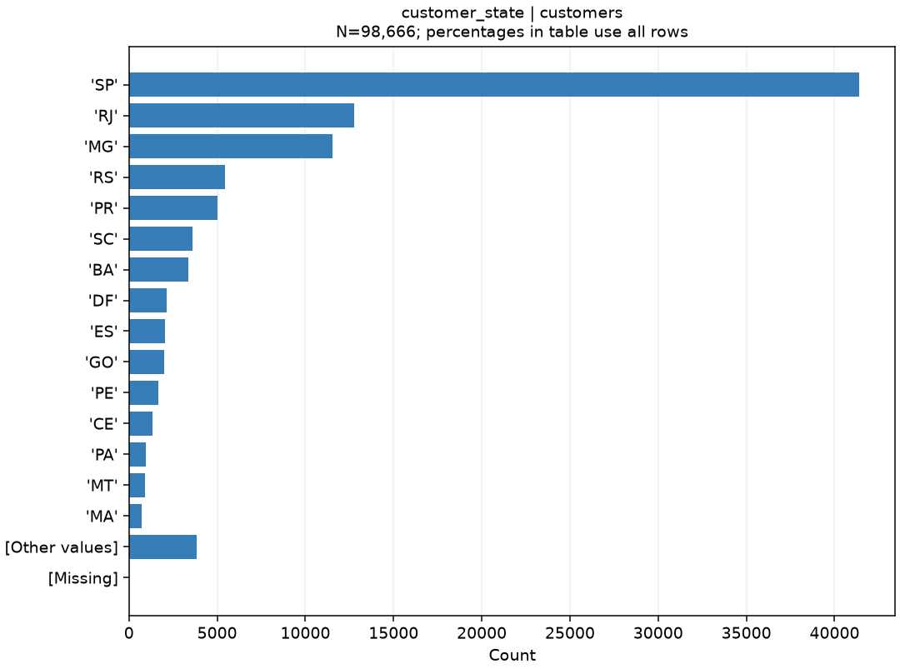

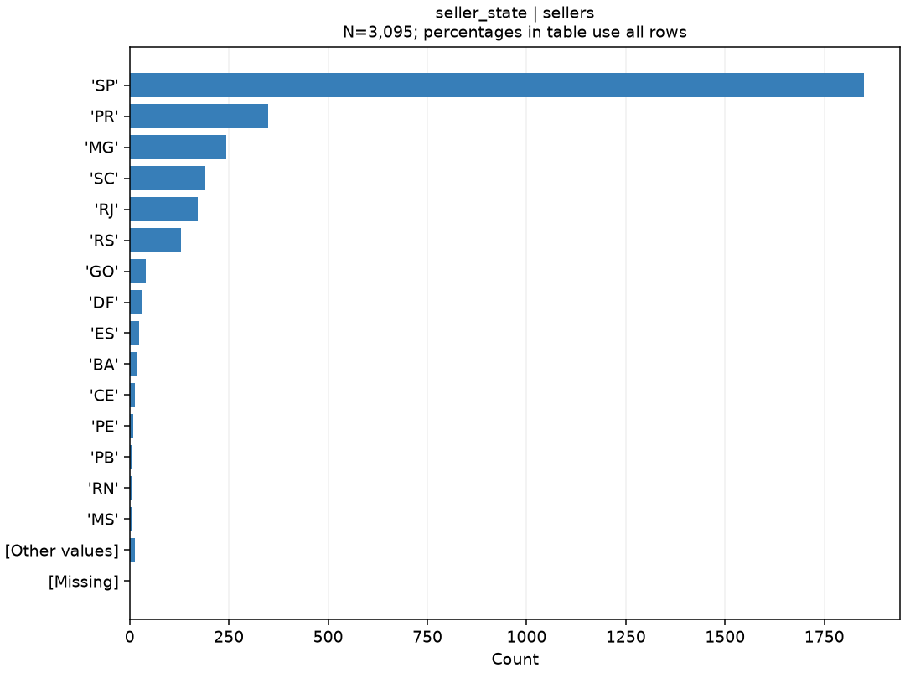

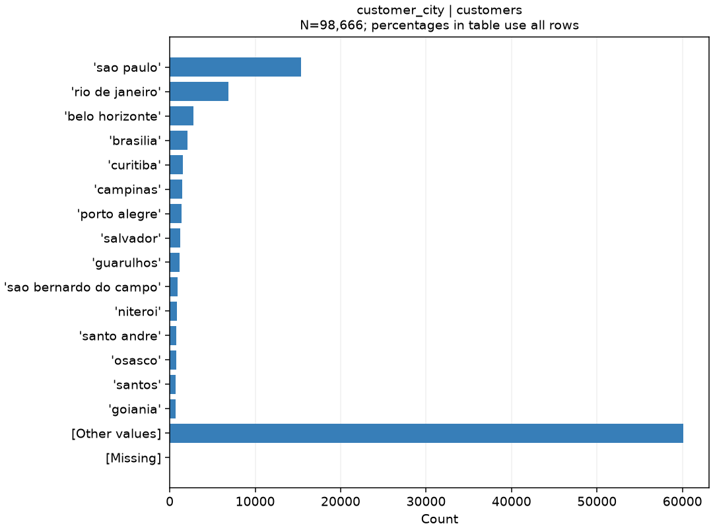

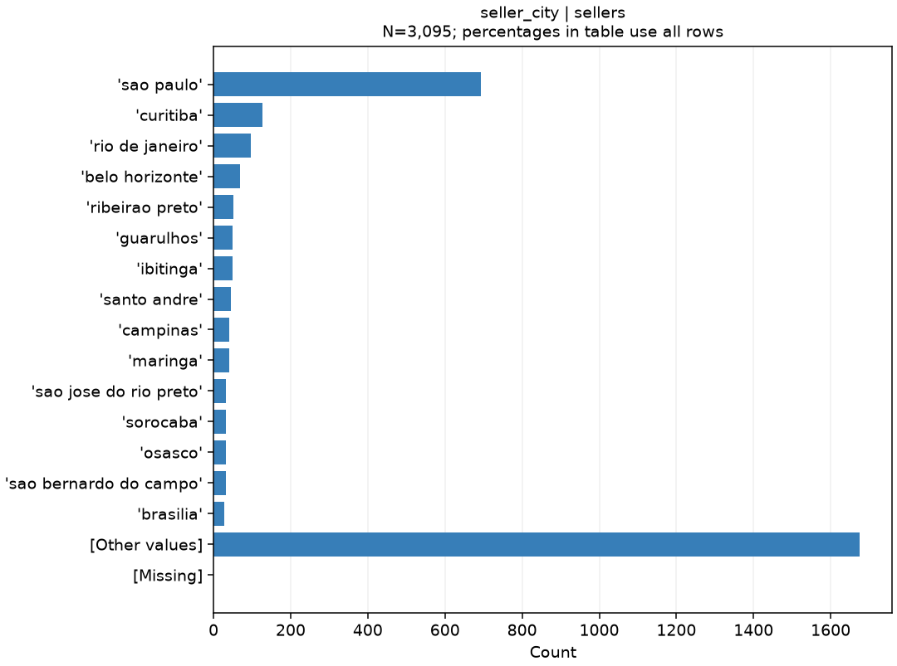

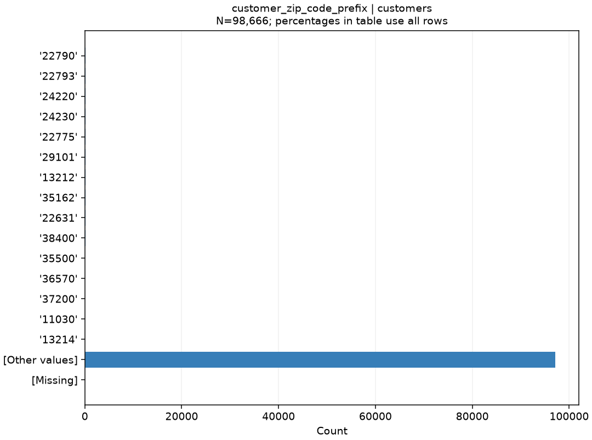

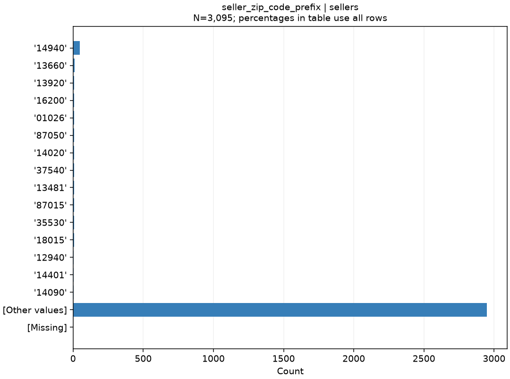

The city/ZIP charts limit the displayed labels. Other combines observations in values outside the top 15; it is not the number of distinct remaining cities or ZIP prefixes.

## 5. Timestamp coverage and distributions

### 5.1. Timestamp ranges

| Column | Counting grain | Minimum | Maximum |
|---|---|---|---|
| Purchase | Order | 2016-09-04 21:15:19 | 2018-09-03 09:06:57 |
| Approved | Order | 2016-09-15 12:16:38 | 2018-09-03 17:40:06 |
| Carrier Handoff | Order | 2016-10-08 10:34:01 | 2018-09-11 19:48:28 |
| Customer Delivery | Order | 2016-10-11 13:46:32 | 2018-10-17 13:22:46 |
| Estimated Delivery | Order | 2016-10-04 00:00:00 | 2018-10-25 00:00:00 |
| Shipping Limit | Item | 2016-09-19 00:15:34 | 2020-04-09 22:35:08 |

None of the six timestamps has nonzero subsecond precision. **All 98,666 Estimated Delivery values are 00:00:00**, across 450 distinct dates. The four core timestamps and Shipping Limit have non-midnight times. Hour distributions use the stored clock; no timezone conversion was applied.

### 5.2. Month, date, weekday and hour distributions

Each figure contains four panels: month, top 15 dates plus Other/Missing, weekday and hour. The denominator is all orders/items for the timestamp, including missing values.

Purchase orders peak in **November 2017: 7,451 orders**. Counts at the ends of the observed range include **3 in September 2016**, **308 in October 2016**, **1 in December 2016** and **1 in September 2018**; there were no purchases in November 2016. The busiest purchase hour is **16:00: 6,628 orders**. The most frequent approval hour is **02:00: 7,002 orders**.

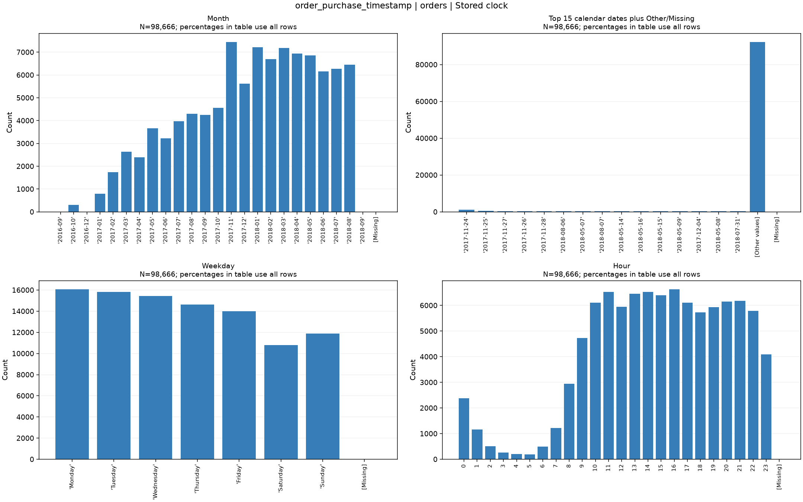

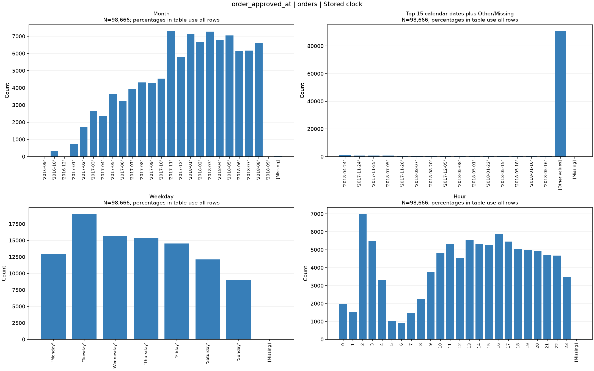

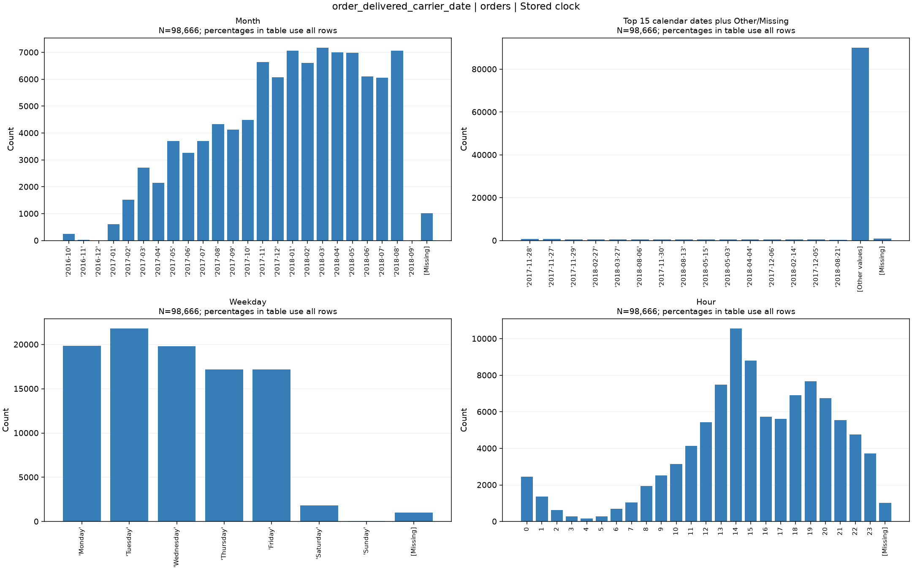

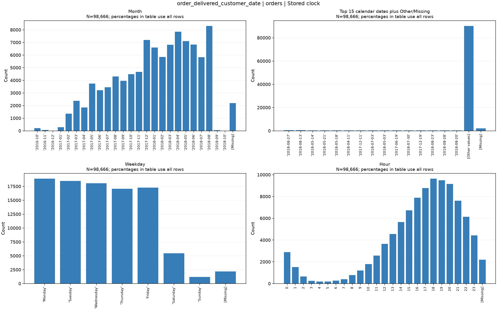

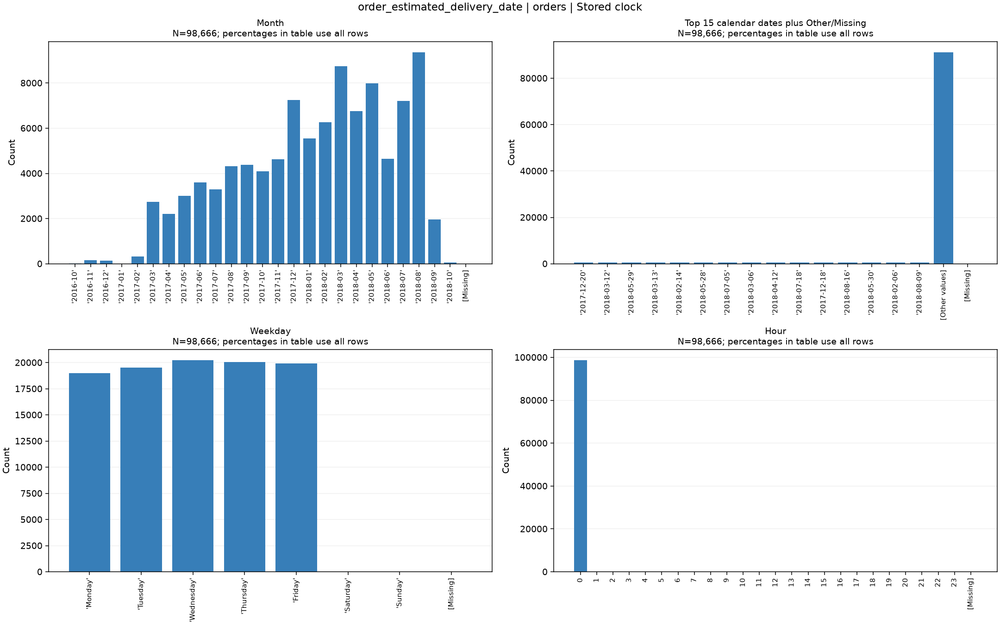

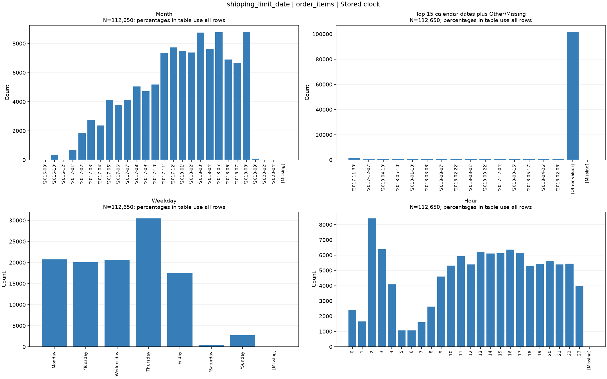

## 6. Timestamp ordering and shipping deadlines

### 6.1. Timestamp comparisons with observed flags

At least one observed ordering flag occurs in **1,382 / 98,666 orders (1.4007%)**. Rates in the table use only orders with both timestamps available for the relevant comparison.

| Comparison | Comparable orders | Not comparable | Flagged orders | Rate / comparable | Reversal within same day | Reversal to earlier date |
|---|---:|---:|---:|---:|---:|---:|
| Carrier before Approved | 97,643 | 1,023 | 1,359 | 1.3918% | 679 | 680 |
| Customer Delivery before Carrier | 96,475 | 2,191 | 23 | 0.0238% | 3 | 20 |
| Carrier before Purchase | 97,657 | 1,009 | 166 | 0.1700% | 164 | 2 |
| Customer Delivery before Approved | 96,462 | 2,204 | 61 | 0.0632% | 23 | 38 |

The comparisons **Approved before Purchase**, **Customer Delivery before Purchase** and **Estimated Delivery before the Purchase date** each have **0 flags**, among 98,652; 96,476; and 98,666 comparable orders, respectively. The Estimated comparison uses calendar dates; the others use full timestamps.

The flagged sets overlap, so row counts cannot be added to get the number of orders with any flag. Missing timestamps remain not comparable; they do not confirm valid ordering.

Among orders flagged for Carrier before Approved, **1,350 are delivered** and **9 are shipped**. All **23 Customer Delivery before Carrier flags** are delivered.

### 6.2. Overlap within delivered orders

| Among 96,478 delivered orders | No observed ordering flag | At least one observed ordering flag |
|---|---:|---:|
| All four core timestamps present | 95,082 | 1,373 |
| At least one core timestamp missing | 23 | 0 |

Of the delivered orders, 95,082 have all four core timestamps and no observed ordering flag; 1,373 have all four timestamps and at least one flag; 23 are missing a core timestamp and have no observed flag.

### 6.3. Purchase month among flagged orders

Among **1,359 orders with Carrier before Approved**, **566 were purchased in July 2018 (41.6483%)** and **393 in April 2018 (28.9183%)**. Among **23 orders with Customer Delivery before Carrier**, **11 were purchased in July 2017 (47.8261%)**.

The following charts count within the flagged cohorts. They do not show the proportion of all purchases in each month that were flagged.

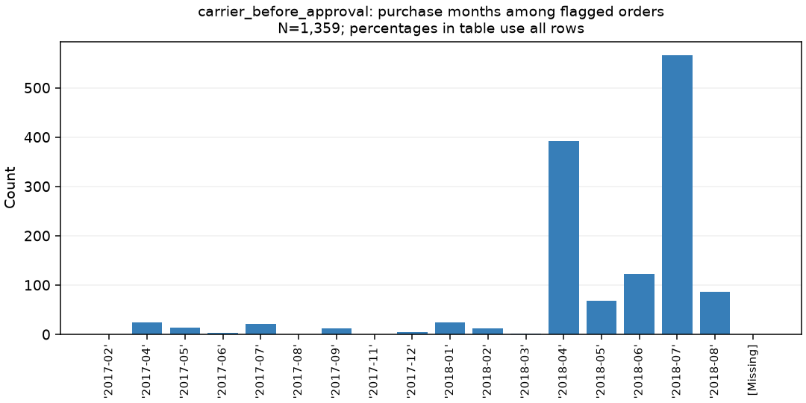

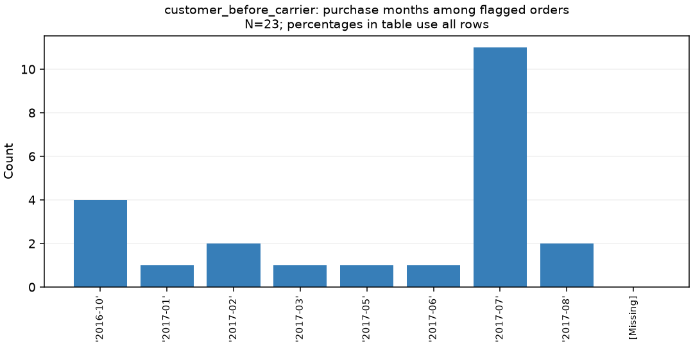

### 6.4. Shipping deadlines beyond observed purchase years

No Shipping Limit precedes Purchase among **112,650 items with both timestamps present**. **Four items across 3 orders and 3 order–seller groups** have Shipping Limit dates in **2020**, after the latest observed purchase year, 2018. All four belong to seller `7a241947449cc45dbfda4f9d0798d9d0`.

| `order_id` | Item | Status | Purchase | Shipping Limit |
|---|---:|---|---|---|
| `13bdf405f961a6deec817d817f5c6624` | 1 | canceled | 2017-03-16 02:30:51 | 2020-02-05 03:30:51 |
| `9c94a4ea2f7876660fa6f1b59b69c8e6` | 1 | shipped | 2017-03-14 19:23:22 | 2020-02-03 20:23:22 |
| `c2bb89b5c1dd978d507284be78a04cb2` | 1 and 2 | delivered | 2017-05-23 22:28:36 | 2020-04-09 22:35:08 |

The delivered order in the table has Carrier Handoff at **2017-05-29 02:03:28** and Customer Delivery at **2017-06-09 13:35:54**. The four deadlines fall in 2020, while the latest observed purchase year is 2018.

## 7. Text formats

Across text columns checked at item and entity grain, each of the following counts is **0**: non-string non-null values; blanks; leading/trailing whitespace; control characters; replacement character `�`; candidate groups formed by temporary strip/casefold keys.

String IDs match the 32-character lowercase hexadecimal pattern; ZIP prefixes match exactly five ASCII digits; states match exactly two uppercase letters. These are string-format checks; addresses and official state-code lists were not validated.

The observed formatting difference is **3 / 3,095 sellers (0.0969%)** with repeated internal spaces in city names. They occur in **56 items across 54 orders**:

| Seller ID | State | Original string shown with `[space]` markers |
|---|---|---|
| `ea566164622c6b439516ab18062c42cd` | SP | `sao[space][space]paulo` |
| `8a1ff5c35f6595a73fef4c7b96e4908a` | PR | `sao[space][space]jose[space]dos[space]pinhais` |
| `e88165a185134e13fdfc85d4fa654db8` | SP | `ferraz[space]de[space][space]vasconcelos` |

Using only a temporary key that collapses whitespace and casefolds within the same state, the corresponding single-space city forms occur among **694 sellers** for `sao paulo`/SP, **9 sellers** for `sao jose dos pinhais`/PR and **3 sellers** for `ferraz de vasconcelos`/SP. Each repeated-space spelling occurs for one seller. The source retains these city spellings as separate values.

## 8. Order composition

| Characteristic | Orders / 98,666 | Rate |
|---|---:|---:|
| Multiple items | 9,803 | 9.9355% |
| Multiple products | 3,236 | 3.2798% |
| Multiple sellers | 1,278 | 1.2953% |
| Multiple distinct Shipping Limit values | 336 | 0.3405% |
| Multiple seller states | 510 | 0.5169% |
| Both equal and different customer–seller state pairs among items | 247 | 0.2503% |

All **336 orders with multiple deadlines** and all **247 orders with a mix of equal/different state pairs** are in the multiple-seller group. These groups overlap in **63 orders**. The 1,278 multiple-seller orders break down as follows:

| Multiple deadlines | Mixed state pairs | Orders |
|---|---|---:|
| No | No | 758 |
| Yes | No | 273 |
| No | Yes | 184 |
| Yes | Yes | 63 |

There are **100,010 order–seller groups**. **Zero groups have multiple distinct deadlines within the same order–seller group**. Every item has a deadline and enough original state values for comparison; **zero orders have nonconsecutive item numbering**. Order-level counts retain the observed item, seller, deadline and state-pair multiplicity.
