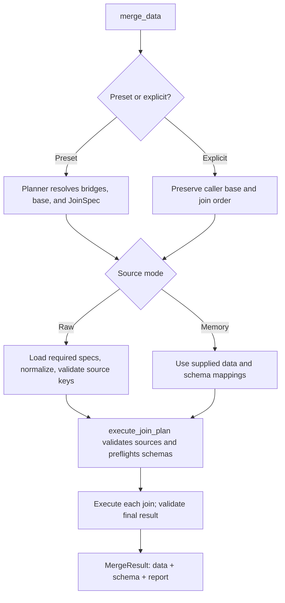
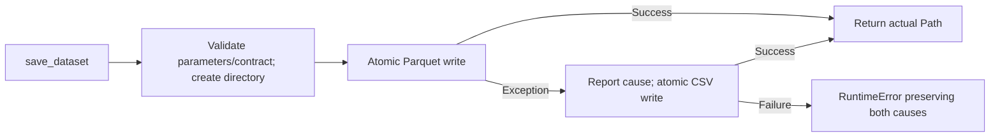
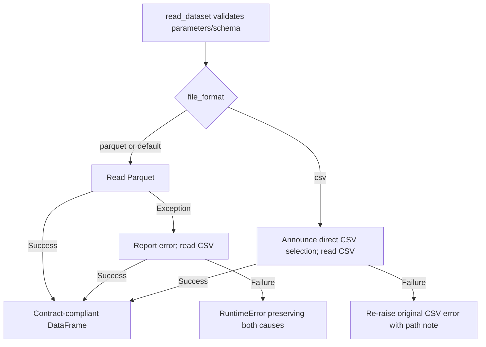

# Merge Technical Reference

This reference documents the merge architecture, data contracts, execution flow, and function interfaces for code review, maintenance, and extension. For dataset selection and executable examples, see the [Merge User Guide](User_Guide.md).

Scope: `src/pipeline`, supporting modules, the merge notebook, tests, and related configuration. Paths are relative to the repository root. Documentation is maintained separately; neither the pipeline nor the notebook generates or updates these files.

<a id="start"></a>
## 1. Navigation and conventions

### 1.1. Reading paths

1. Sections **2–4** describe the file layout, data contracts, and execution flow.
2. Section **5** covers entry points; sections **6–8** provide function-level reference.
3. Sections **9–11** cover artifacts, testing, troubleshooting, and extension.
4. [Appendix A](#test-reference) lists individual fixtures, helpers, and tests independently of the main execution flow.

| Task | Reference |
|---|---|
| Merge a standard combination or explicit plan | [`merge_data()`](#fn-merge-data) |
| Merge and save the full dataset | [`run_pipeline()`](#fn-run-pipeline) |
| Read raw/interim data by name | [`load_data()`](#fn-load-data) |
| Save or read a schema-aware result | [`save_dataset()`](#fn-save-dataset), [`read_dataset()`](#fn-read-dataset) |
| Review data, plan, and result structures | [Dataclasses](#data-contracts) |
| Inspect a single join | [`execute_join()`](#fn-execute-join) |
| Review the test suite | [Section 10](#testing) |
| Locate a failure | [Troubleshooting](#troubleshooting) |

### 1.2. Reference conventions

- **Execution flow before implementation detail:** entry points precede codecs, compatibility adapters, and the test catalogue.
- **Consistent production function entries:** signature, **Purpose**, **Inputs**, **Returns**, **Behavior**, and **Notes/errors**.
- **One primary explanation per concept:** other sections link to it; executable usage examples remain in the user guide.
- **Declarations and observations are distinct:** schemas and registries define expectations, validators check data, reports record in-memory merge observations, and files are created only when a saver runs.

**Contents**

- [2. Code architecture](#architecture)
- [3. Data contracts](#data-contracts)
- [4. Execution flow](#flows)
- [5. Entry points and notebook](#entrypoints)
- [6. Contract and merge reference](#core-reference)
- [7. Storage reference](#io-reference)
- [8. Compatibility interfaces](#compatibility)
- [9. Artifacts and data lifecycle](#artifacts)
- [10. Testing](#testing)
- [11. Limits, troubleshooting, and extension](#maintenance)
- [Appendix A. Fixtures, helpers, and tests](#test-reference)
- [Appendix B. Standard output names](#output-names)

### 1.3. Terminology

| Term | Project meaning |
|---|---|
| Module / package | A .py file / a Python directory with __init__.py in the current layout |
| Schema / contract | Column names/order, dtypes, unique key, and required columns |
| PK / FK | A table's unique key / a key referencing another table |
| Grain | Whether a row represents an item or an order |
| Preset / explicit | Automatically planned relationships / caller-defined joins |
| Bridge | An additional source required to connect selected tables |
| Cardinality | Key relationship: 1:1, 1:m, m:1, m:m |
| Caller | Code invoking a function |
| Adapter / wrapper | A retained interface delegating to shared implementation |
| Round-trip | Save and reload with value, dtype, and missing-mask comparison |
| Atomic replace | Complete a temporary file before replacing the destination |

<a id="architecture"></a>
## 2. Code architecture

### 2.1. Merge-related file layout

```text
src/
├── __init__.py
├── paths.py
├── config.py
├── data_loader.py
└── pipeline/
    ├── __init__.py
    ├── api.py
    ├── run_merge.py
    ├── contracts/
    │   ├── __init__.py
    │   ├── schema.py
    │   ├── normalizer.py
    │   ├── validator.py
    │   └── schema_derivation.py
    ├── merging/
    │   ├── __init__.py
    │   ├── planner.py
    │   ├── merger.py
    │   ├── registry.py
    │   └── reporting.py
    └── io/
        ├── __init__.py
        ├── loader.py
        ├── dataset_io.py
        ├── parquet_io.py
        ├── csv_codec.py
        ├── csv_types.py
        ├── csv_io.py
        └── atomic_io.py
notebooks/
└── 00_data_merging.ipynb
tests/
├── conftest.py
├── test_merge_contracts.py
├── test_merge_joins.py
├── test_merge_presets.py
├── test_merge_storage.py
├── test_merge_reporting.py
└── test_merge_pipeline.py
pytest.ini
requirements.txt
.gitignore
```

The implementation contains **25 production Python files**: 21 in pipeline and four directly under src; **33 explicitly written functions/methods** and **six classes**. Dataclass-generated constructors are described through fields rather than counted as handwritten functions. The notebook defines one additional root-location helper. Tests are covered in section 10 and Appendix A.

### 2.2. Responsibilities and dependencies

| Component | Responsibility | Reference |
|---|---|---|
| `contracts/` | Declare, normalize, and validate data; derive join schemas | [Section 3](#data-contracts), [6.1–6.3](#core-reference) |
| `merging/` | Plan relationships, execute joins, register combinations, format reports | [6.4–6.7](#planner) |
| `io/` | Typed raw loading, result storage, codecs, and atomic writes | [Section 7](#io-reference) |
| `api.py` | Coordinate planner, loader, and executor | [`merge_data()`](#fn-merge-data) |
| `run_merge.py` | Full CLI workflow and retained wrappers | [`run_pipeline()`](#fn-run-pipeline), [section 8](#compatibility) |
| `data_loader.py` | Source names and raw/interim reader dispatch | [`load_data()`](#fn-load-data) |
| `paths.py`, `config.py` | Shared paths and repository seed setting | [2.3](#configuration) |
| Notebook | Invoke shared functions, display results, compare baseline | [5.4](#notebook) |
| Tests | Verify behavior with fixtures, references, and assertions | [Section 10](#testing) |

The API calls lower-level components. Normalization and validation helpers do not invoke the full pipeline or write documentation. The shared join algorithm lives in merger.py and is reused by the compatibility adapter.

The five `__init__.py` files in src, pipeline, and its three subpackages are empty. Import from the full module, such as `from src.pipeline.api import merge_data`; the package root does not re-export every interface. This also limits circular imports between loading and merging. The tests and notebooks directories do not require additional `__init__.py` files for the current workflow.

<a id="configuration"></a>
### 2.3. Configuration and import side effects

`../../src/paths.py` derives the root from its own location rather than a machine-specific drive:

| Constant | Relative path / role |
|---|---|
| PROJECT_ROOT, DATA_DIR | Repository root, data/ |
| RAW_DIR | data/raw/ — source data |
| INTERIM_DIR | data/interim/ — merged data |
| PROCESSED_DIR | data/processed/ — cleaned data |
| OUTPUT_DIR, FIGURES_DIR, TABLES_DIR | outputs/, outputs/figures/, outputs/tables/ |
| NOTEBOOKS_DIR, REPORTS_DIR | notebooks/, reports/ |
| PRESENTATION_DIR, DOCS_DIR | presentation/, docs/ |

Importing paths.py creates interim, processed, figures, and tables directories if needed, including parents. It does not create raw CSV files or document contents. Imports can therefore create directories before a merge runs.

`../../src/config.py` defines RANDOM_SEED=42; the merge implementation does not use it. Importing run_merge.py can configure console logging; see [5.3](#fn-run-pipeline).

<a id="data-contracts"></a>
## 3. Data contracts

<a id="schema"></a>
### 3.1. Dataclasses in `../../src/pipeline/contracts/schema.py`

Dataclasses provide explicit configuration and result fields. **Constructing an instance does not validate external data.** All four use frozen=True, but nested lists, dictionaries, and DataFrames remain mutable. Create separate configurations instead of modifying canonical constants for one operation.

#### `TableSchema`

Describes a DataFrame independently of its storage format.

| Input field | Meaning / default |
|---|---|
| `columns: List[str]` | Required ordered column names |
| `dtypes: Dict[str, str]` | Required pandas dtype for each column |
| `unique_key: List[str]` | One complete key; [] means no declared uniqueness constraint |
| `non_nullable_columns: List[str]` | Required non-missing columns; default [] |

The constructor returns a schema for validators, executors, and I/O. Uniqueness of `(order_id, order_item_id)` applies to the **pair**, not to order_id independently.

#### `JoinSpec`

Describes one join to a right-side table.

| Input field | Meaning / default |
|---|---|
| `table: str` | Required right-table name |
| `on` | Same-name key or key list; default None |
| `left_on`, `right_on` | Corresponding differently named keys of equal length; default None |
| `how` | Default left; also inner, right, outer |
| `validate` | Default m:1; also 1:1, 1:m, m:m |
| `columns` | Right columns to select; None selects all; right join keys are retained |
| `rename: Dict[str, str]` | Renames of selected non-key right columns; default {} |
| `require_match: bool` | Require every left key to exist on the right; default True |

Use on or both left_on/right_on, not both forms. Construction declares the operation without proving its actual cardinality.

#### `MergeResult`

| Input/output field | Content |
|---|---|
| `data: DataFrame` | Result table, retained by reference |
| `schema: TableSchema` | Output contract |
| `report: Dict[str, Any]` | In-memory plan, counts, and checks; default {} |

Construction neither copies nor validates data. With eq=False, result equality uses identity; compare DataFrames with pd.testing.assert_frame_equal(). Mutating data does not refresh the report.

#### `TableLoadSpec`

| Input field | Content |
|---|---|
| `dataset_name: str` | Registered raw dataset name |
| `usecols: List[str]` | Selected columns in declared order |
| `dtypes: Dict[str, str]` | Non-timestamp dtypes; default {} |
| `date_columns: List[str]` | Timestamp columns declared as datetime64[us]; default [] |

Each column must have exactly one dtype or date declaration. A spec does not register a raw filename in DATASETS. Default containers use default_factory and are separate per instance.

<a id="source-schema"></a>
### 3.2. Source and full schemas

| Declaration | Role |
|---|---|
| ORDER_ITEMS_SPEC, ORDERS_SPEC, CUSTOMERS_SPEC, PRODUCTS_SPEC, SELLERS_SPEC | Selected columns and dtypes for five sources |
| SOURCE_PRIMARY_KEYS | Shared source keys for loading, planning, and validation |
| EXPECTED_FINAL_COLUMNS | The ordered 25-column full schema |
| MANDATORY_NON_NULL_COLUMNS | Five required full-result IDs |
| ALL_TIMESTAMP_COLUMNS, ZIP_COLUMNS | Six timestamps and two ZIP columns |
| BENCHMARK_ROW_COUNT | Reference count 112650; not a target to force inputs to match |
| FULL_MERGE_SCHEMA | Full contract with key (order_id, order_item_id) |

<a id="fn-build-source-schema"></a>
#### `build_source_schema()`

`build_source_schema(spec, *, key_columns=None) -> TableSchema`

- **Purpose:** convert a load spec into a source contract with a key.
- **Inputs:** TableLoadSpec and optional key override; otherwise use SOURCE_PRIMARY_KEYS.
- **Returns:** independent schema in usecols order, timestamps in microseconds, PK components declared non-null.
- **Behavior:** validate names, columns, dtype/date coverage, and keys, then construct new containers without reading data.
- **Notes/errors:** duplicate, missing, extra, or overlapping declarations and invalid keys raise TypeError/ValueError. Unregistered custom keys require key_columns.

### 3.3. Sources and grain

DATASETS in src/data_loader.py contains nine names. Only the first five participate in standard merge planning:

| Source | File under data/raw/ | Reference rows / selected columns / PK |
|---|---|---|
| order_items | olist_order_items_dataset.csv | 112650 / 7 / (order_id, order_item_id) |
| orders | olist_orders_dataset.csv | 99441 / 8 / order_id |
| customers | olist_customers_dataset.csv | 99441 / 4 / customer_id |
| products | olist_products_dataset.csv | 32951 / 6 / product_id |
| sellers | olist_sellers_dataset.csv | 3095 / 4 / seller_id |
| geolocation | olist_geolocation_dataset.csv | Outside presets |
| payments | olist_order_payments_dataset.csv | Outside presets |
| reviews | olist_order_reviews_dataset.csv | Outside presets |
| category_translation | product_category_name_translation.csv | Outside presets |

**Full:** 112,650 rows, 25 columns, 98,666 distinct orders; one item per row. **Orders + customers:** 99,441 rows, 11 columns; one order per row. These are reference-data observations, not universal input constraints.

Canonical dtypes: IDs/ZIP/text use string; order_item_id uses int64; price/freight/physical attributes use float64; six timestamps use datetime64[us]. See the [25-column schema](User_Guide.md#schema) for individual fields.

<a id="downstream-notes"></a>
### 3.4. Downstream data considerations

- The full result is item-based: its 98,666 orders do not represent all 99,441 orders rows. Order/customer attributes repeat across items; count orders using distinct order_id.
- Shipping limit, price, and freight originate at item level. Merge does not select a representative seller or deadline for a multi-item/multi-seller order.
- Product weight uses grams and dimensions use centimeters; a product attribute is not an aggregated order weight.
- ZIP codes are text; canonical timestamps have no timezone. Merge does not infer timezone or business days.
- Required IDs do not imply complete timestamps/attributes. Allowed missing values are retained.
- customer_unique_id is excluded; customer_id is not a substitute for cross-order customer identity.
- Delivered-only filtering, invalid/missing time removal, late/delay/route/bulky features, and additional source integrations belong to separately defined downstream stages.

<a id="flows"></a>
## 4. Execution flow

### 4.1. Merge request to result



The preset graph is order_items—orders—customers, order_items—products, and order_items—sellers. Selecting customers + products still requires item and orders bridges, so its resolved grain is item-level.

A single join follows **schema derivation → input validation → FK checks → working copies → precision/invalid-key protection → pandas merge → normalization → output validation**.

Plan preflight precedes the **first join**, not necessarily all raw reads. Merge does not use interim data as an input cache or save automatically.

### 4.2. Save and read





Invalid declarations stop before format attempts. A per-file failure against a valid declaration can trigger fallback. When both files exist, default reading still prefers Parquet rather than modification time. See [7.1](#dataset-io) for pre-I/O versus format-specific errors.

<a id="entrypoints"></a>
## 5. Entry points and notebook

<a id="api"></a>
### 5.1. `../../src/pipeline/api.py`

<a id="fn-merge-data"></a>
#### `merge_data()`

```text
merge_data(*, tables=None, base=None, joins=None,
           source_tables=None, source_schemas=None) -> MergeResult
```

- **Purpose:** merge a preset or explicit plan through the shared executor.
- **Inputs:** tables containing 2–5 standard names, **or** both base and a joins sequence; optionally both source-name-to-DataFrame and source-name-to-schema mappings.
- **Returns:** MergeResult with mode/source, requested/bridge/resolved tables, grain, sources, and per-step reports.
- **Behavior:** construct the configuration, obtain required sources, execute_join_plan(), and attach mode information.
- **Notes/errors:** all arguments are keyword-only. Missing/conflicting modes or only one memory mapping are invalid. Memory data must already satisfy contracts; raw mode supports only five registered specs. No implicit memory normalization or saving. Configuration/contract errors raise TypeError/ValueError; missing raw raises FileNotFoundError; cardinality can raise MergeError.

| Mode | Raw sources | Memory sources |
|---|---|---|
| Preset | Required sources loaded through canonical specs | Both mappings required; schemas must equal canonical contracts |
| Explicit | Required names still limited to five specs | Custom names/schemas supported; joins=[] is valid |

Explicit mode preserves order, adds no bridges, and reports grain=None. Unused mapping entries are ignored. A repeated raw source is loaded once. Names are case-sensitive; supply a sequence such as list/tuple rather than a string or set.

<a id="data-loader"></a>
### 5.2. `../../src/data_loader.py`

DATASETS maps nine raw names to filenames. INTERIM_DATASETS is constructed at import and holds 26 plans/schemas. Neither registry certifies file existence or stores data/run history.

<a id="fn-load-data"></a>
#### `load_data()`

`load_data(name: str, stage: str="raw", **kwargs) -> DataFrame`

- **Purpose:** read registered raw/interim datasets, or custom interim data with a schema.
- **Inputs:** name and stage; raw forwards kwargs to pandas, while interim accepts only file_format/schema.
- **Returns:** DataFrame; interim reading restores dtypes and checks the contract.
- **Behavior:** raw resolves the file and dispatches by suffix; interim chooses a registered/custom schema and calls read_dataset() under INTERIM_DIR.
- **Notes/errors:** stage defaults to raw; merged names require stage="interim". Registered contracts cannot be weakened; custom names require schema. Interim rejects dtype/usecols and other parser kwargs; select columns after reading. Invalid names/stages raise ValueError; invalid options/schema types raise TypeError; reader errors propagate.

Raw loading alone does not enforce typed merge contracts; use [load_table()](#fn-load-table). The raw branch gives file_format/schema no special meaning and forwards them to pandas unchanged.

<a id="fn-load-all"></a>
#### `load_all()`

`load_all() -> Dict[str, DataFrame]` describes the actual return value; the source has no return annotation.

- **Purpose:** read the entire raw registry.
- **Inputs:** none.
- **Returns:** dictionary of nine DataFrames.
- **Behavior:** call load_data(name) for each DATASETS entry.
- **Notes/errors:** requires all files and enough memory; a source failure aborts the call. This is not the typed merge loader or an efficient route for a small preset.

<a id="run-merge"></a>
### 5.3. `../../src/pipeline/run_merge.py`: full workflow

<a id="fn-run-pipeline"></a>
#### `run_pipeline()`

`run_pipeline() -> DataFrame`

- **Purpose:** strictly merge and save the full dataset.
- **Inputs:** none; uses configured raw paths and all MERGE_TABLE_SPECS.
- **Returns:** the full DataFrame **after a successful save**.
- **Behavior:** merge_data(tables=list(MERGE_TABLE_SPECS)), then save_merged_dataset(..., INTERIM_DIR), announce completion, and return data.
- **Notes/errors:** does not return schema/report/path; call the API and saver separately for them. Load/merge errors occur before saving. Save failures propagate without successful-completion reporting. No cleaning or legacy soft checks are run.

From the repository root:

```powershell
python -m src.pipeline.run_merge
```

This command writes interim output. Importing the module does not run the pipeline; execution requires a function call or the `__main__` entry point.

The module calls logging.basicConfig() at INFO level with timestamp/level/logger formatting and StreamHandler(sys.stdout); the logger is olist_pipeline. It does not configure a FileHandler. A host application that previously configured the root logger may control effective logging. Retained wrappers are described in [section 8](#compatibility).

<a id="notebook"></a>
### 5.4. `../../notebooks/00_data_merging.ipynb`

Execute the four code cells in order:

| Cell | Responsibility | Outputs / variables |
|---|---|---|
| 0 | Autoreload, root discovery, imports | Raw/interim paths; PROJECT_ROOT, RAW_DIR, INTERIM_DIR |
| 1 | Full merge and save | merge_result, df_merged, saved_path; shape/head |
| 2 | Format and display reports | merge_report_tables and eight tables |
| 3 | Full contract and baseline checks | Expected / Actual / Passed; error on failure |

<a id="fn-find-project-root"></a>
#### `find_project_root()`

`find_project_root(start_path: Path) -> Path`

- **Purpose:** locate the repository root for notebook execution.
- **Inputs:** starting path; the cell passes Path.cwd().
- **Returns:** nearest matching directory among the start and ancestors, containing src/ and requirements.txt.
- **Behavior:** inspect the start and parent directories. After return, the calling cell adds the root to sys.path if needed.
- **Notes/errors:** defined in the notebook, not a package API. Failure raises FileNotFoundError; an external working directory may not resolve the project. It does not check the Git branch.

**Output semantics:**

- df_merged references merge_result.data; it is not a copy.
- Cell 2 uses pd.option_context() for complete display and restores settings afterward. The formatter does not display anything itself.
- Cell 3 requires the full schema and a recorded order_items source count, validates the contract, and checks **112650 rows / 25 columns / 98666 orders / output rows equal source items**.
- **Cell 1 saves before cell 3.** A baseline failure does not roll back the saved file. The saver has checked the contract; the baseline separately checks the reference input version.
- The ipynb stores code, metadata, and execution outputs when saved. No cell writes or updates Markdown/README files.

<a id="core-reference"></a>
## 6. Contract and merge reference

These functions do not load or save datasets. The registry constructs in-memory declarations; reporting constructs tables for the caller to display.

<a id="normalizer"></a>
### 6.1. `../../src/pipeline/contracts/normalizer.py`

<a id="fn-normalize-table-types"></a>
#### `normalize_table_types()`

`normalize_table_types(df, schema, *, table_name="dataset") -> DataFrame`

- **Purpose:** normalize declared columns without silently losing values.
- **Inputs:** DataFrame, schema, and an error-context table label.
- **Returns:** independent copy preserving index, row/column order, extra columns, and missing values.
- **Behavior:** parse/cast supported types and compare values, precision, and missing masks; datetime parsing uses format="mixed" and an explicit target unit.
- **Notes/errors:** does not validate PK/FK, fill missing data, trim IDs, or drop extras. Text must already be strings; booleans must be actual booleans, not "True". Numeric timestamps without explicit units are rejected. Unsafe conversions raise ValueError; a non-DataFrame raises TypeError. Lost ZIP zeros cannot be inferred.

<a id="validator"></a>
### 6.2. `../../src/pipeline/contracts/validator.py`

The four shared validators do not mutate data. Schema, source key, FK, and complete contract checks have distinct scopes.

<a id="fn-validate-table-schema"></a>
#### `validate_table_schema()`

`validate_table_schema(df, schema, *, table_name="dataset") -> None`

- **Purpose:** verify exact structure and dtypes.
- **Inputs:** DataFrame, schema, and table label.
- **Returns:** None on success.
- **Behavior:** detect duplicate/missing/extra columns, wrong order, inconsistent declarations, and actual dtype differences including datetime units.
- **Notes/errors:** does not check PK, non-null values, FK, or row counts. Invalid types/structure raise TypeError/ValueError; a correctly typed empty table is valid.

<a id="fn-validate-source-keys"></a>
#### `validate_source_keys()`

`validate_source_keys(df, table_name, *, key_columns=None) -> None`

- **Purpose:** validate one complete primary key.
- **Inputs:** DataFrame and registered source name, or explicit key_columns.
- **Returns:** None when keys are present, non-blank, and unique as tuples.
- **Behavior:** validate declarations/key columns, nulls, whitespace-only strings, and duplicate key tuples.
- **Notes/errors:** key declarations cannot be empty; an empty table with valid key columns is allowed. Custom sources need explicit keys. Invalid declarations/data raise TypeError/ValueError. Duplicate counts exclude the first occurrence.

<a id="fn-validate-foreign-keys"></a>
#### `validate_foreign_keys()`

`validate_foreign_keys(left_df, right_df, join, *, left_table_name="left") -> Dict[str, int]`

- **Purpose:** check left-key membership in the right source.
- **Inputs:** two DataFrames, JoinSpec, and a left label.
- **Returns:** left_rows, matched_rows, unmatched_rows, unmatched_keys, invalid_key_rows.
- **Behavior:** compare whole tuples; null/blank keys never match, even on both sides. Invalid right keys are ignored for membership without deleting source rows.
- **Notes/errors:** matches count **left input rows**, not expanded output rows. Strict unmatched keys raise ValueError; permissive mode returns counts. This function does not join or check cardinality/dtypes. Invalid configuration raises TypeError/ValueError.

<a id="fn-validate-table-contract"></a>
#### `validate_table_contract()`

`validate_table_contract(df, schema, *, table_name="dataset", expected_rows=None) -> None`

- **Purpose:** validate a complete table contract.
- **Inputs:** DataFrame, schema, label, and optional justified expected row count.
- **Returns:** None on success.
- **Behavior:** validate declarations, structure/dtypes, optional count, declared PK, and remaining required attributes.
- **Notes/errors:** unique_key=[] does not infer a key from the table name. Attribute non-null rules inspect missing values; PK also rejects blank strings. Expected count must be a non-negative integer, excluding bool/float; None omits the check. Violations raise TypeError/ValueError; no benchmark or business rules are inferred.

The retained MergeValidator class is covered in [8.3](#legacy-validator).

<a id="schema-derivation"></a>
### 6.3. `../../src/pipeline/contracts/schema_derivation.py`

<a id="fn-derive-join-schema"></a>
#### `derive_join_schema()`

`derive_join_schema(left, right, join) -> TableSchema`

- **Purpose:** derive a join's output contract before execution.
- **Inputs:** two schemas and JoinSpec, without DataFrames.
- **Returns:** new schema with justified columns, dtypes, key, and non-null rules.
- **Behavior:** retain left columns first, append right columns in source order, always retain right keys, coalesce only paired same-name keys, and promote numpy integers/booleans to nullable types where needed.
- **Notes/errors:** paired key dtypes must match. Selection does not reorder the right schema; renames apply only to selected non-key right columns. Collisions are rejected rather than suffixed. A key survives only when its side is guaranteed present and unexpanded; otherwise it is []. Invalid declarations raise TypeError/ValueError. Runtime checks must still enforce the assumptions.

<a id="planner"></a>
### 6.4. `../../src/pipeline/merging/planner.py`

MERGE_TABLE_SPECS defines item → orders → customers → products → sellers order. MERGE_RELATIONSHIPS defines the four graph edges from section 4. Path discovery treats edges bidirectionally; executable plans retain the configured FK → PK direction.

<a id="fn-resolve-bridge-tables"></a>
#### `resolve_bridge_tables()`

`resolve_bridge_tables(tables: Sequence[str]) -> List[str]`

- **Purpose:** resolve the minimum sources connecting the selection.
- **Inputs:** 2–5 distinct canonical names in a list/tuple.
- **Returns:** requested sources **plus bridges**, in canonical order; not bridges alone.
- **Behavior:** find paths in the fixed tree rather than infer relationships from shared column names.
- **Notes/errors:** string/set inputs, unknown/duplicate names, invalid counts, or disconnected configuration raise TypeError/ValueError.

<a id="fn-build-combination-plan"></a>
#### `build_combination_plan()`

`build_combination_plan(tables: Sequence[str]) -> Dict[str, Any]`

- **Purpose:** construct a canonical preset plan.
- **Inputs:** a valid source-name sequence.
- **Returns:** requested_tables, bridge_tables, resolved_tables, base, joins, grain.
- **Behavior:** call the resolver; use item as base when resolved, otherwise orders for orders + customers; create strict left m:1 joins in canonical order using registered right PKs.
- **Notes/errors:** planning does not validate actual rows. Invalid configuration raises TypeError/ValueError. Preset grain is order_item or order.

<a id="merger"></a>
### 6.5. `../../src/pipeline/merging/merger.py`

<a id="fn-execute-join"></a>
#### `execute_join()`

```text
execute_join(left_df, right_df, left_schema, right_schema, join,
             *, left_table_name="left") -> MergeResult
```

- **Purpose:** execute one validated join through the shared implementation.
- **Inputs:** canonical DataFrames, source schemas, JoinSpec, and left label.
- **Returns:** new data, derived schema, and a single-step report.
- **Behavior:** follow section 4.1; copy/reset working indexes, protect numpy integer/bool columns with nullable types before merging, add an invalid-key guard, merge with sort=False/cardinality validation/no suffixes, remove the guard, and normalize output.
- **Notes/errors:** guard names avoid user collisions. Cardinality still considers original rows, including invalid keys. Invalid configuration/contracts/FK raise TypeError/ValueError; pandas.errors.MergeError includes join context for cardinality failures. No loading, saving, cleaning, or input mutation.

| Row-preservation guarantee | expected_rows |
|---|---|
| Left, 1:1/m:1 | Left row count |
| Inner, strict match, 1:1/m:1 | Left row count |
| Right, 1:1/1:m | Right row count |
| Outer, strict match, 1:1/1:m | Right row count |
| Other cases | None |

Columns follow the derived schema. Column-based joins return a new index. Explicit right/outer joins are not universally guaranteed to retain left row order.

<a id="fn-execute-join-plan"></a>
#### `execute_join_plan()`

`execute_join_plan(base, joins, tables, schemas) -> MergeResult`

- **Purpose:** execute an existing ordered JoinSpec sequence.
- **Inputs:** base name, joins, source mapping, and schema mapping; unused entries are ignored.
- **Returns:** final data/schema and source, sequence, step, and validation reports.
- **Behavior:** validate sources, preflight all schemas, copy the base, execute each shared join, and compare/validate the final schema and contract.
- **Notes/errors:** no automatic bridges, reorder, load, or save. Sources can repeat with valid selection/renaming. joins=[] returns independent data/schema copies with the original index and empty steps. Failures include step/table context and retain their type. Report left_table labels use the base; left_rows describes the accumulated intermediate result.

<a id="registry"></a>
### 6.6. `../../src/pipeline/merging/registry.py`

FULL_DATASET_NAME="merged_order_items" is the full-result alias, not a one-table item result.

<a id="fn-build-dataset-registry"></a>
#### `build_dataset_registry()`

`build_dataset_registry() -> Dict[str, Dict[str, Any]]`

- **Purpose:** construct canonical dataset names, plans, and schemas.
- **Inputs:** none; uses source and graph declarations.
- **Returns:** independent mapping of 26 entries: ten pairs, ten triples, five quadruples, one full.
- **Behavior:** reuse the planner, source-schema builder, and join-schema derivation; entries contain plan fields and schema.
- **Notes/errors:** configurations are independent between calls. No file reads or observed baselines. Non-full names use merged_ plus **requested** names in canonical order separated by `__`. Different requests may resolve to identical sources while retaining different dataset names.

<a id="reporting"></a>
### 6.7. `../../src/pipeline/merging/reporting.py`

<a id="fn-build-merge-report-tables"></a>
#### `build_merge_report_tables()`

`build_merge_report_tables(result: MergeResult) -> Dict[str, DataFrame]`

- **Purpose:** format MergeResult for notebook or UI presentation.
- **Inputs:** an API, plan-executor, or single-join result, including an empty report.
- **Returns:** eight independent DataFrames; empty sections retain stable headers.
- **Behavior:** format scalar display values from data/schema/report using object dtype to preserve exact counts and mixed values.
- **Notes/errors:** no revalidation, display, print, file writes, or pandas option changes. Invalid container types raise TypeError. Input reports follow current producer structures, not arbitrary JSON. Absent metrics are not inferred as zero or passed.

| Table key | Content |
|---|---|
| overview | Mode/source/base/grain, requested/resolved/bridge sources, current shape |
| sources | Selected source shapes |
| joins | Tables, keys, how, cardinality, match policy |
| row_counts | Input/output rows/columns and applicable expectation |
| key_checks | Duplicates, invalid keys, and left-row matching |
| column_selection | Right projection and renames |
| validation | Scope, check, recorded status |
| schema | Expected/actual dtypes, key components, required columns |

**Report semantics:**

- A step records keys/how/cardinality/projection/renaming, counts, duplicate/invalid keys, matching, expected_rows, and validation.
- A plan adds base, tables, join_order, input_shapes, final counts, and steps. The API adds mode/source/requested/bridge/resolved/grain.
- Plan checks: source_contracts, plan_schema, output_contract. Step checks: input_schemas, input_constraints, cardinality, output_schema, output_constraints, row_count_checked.
- row_count_checked=False is **Not applicable**; other false checks are **Failed**. Missing checks are not treated as Passed.
- Duplicate counts use join keys and exclude the first occurrence. Repeated many-side FK values are valid. Schema key flags identify components of **one composite key**.
- Shape and actual dtypes come from the current DataFrame; other counts/statuses were recorded at merge time. Changes to data can make them differ; revalidate the changed table.

<a id="io-reference"></a>
## 7. Storage reference

Typical callers use save_dataset()/read_dataset() or the named loader. Individual format readers/writers do not implement fallback or atomic replacement; those responsibilities belong to orchestration and shared helpers.

<a id="dataset-io"></a>
### 7.1. `../../src/pipeline/io/dataset_io.py`

<a id="fn-save-dataset"></a>
#### `save_dataset()`

`save_dataset(df, output_dir, schema, *, dataset_name) -> Path`

- **Purpose:** save with primary Parquet, CSV fallback, and protected destination replacement.
- **Inputs:** contract-compliant DataFrame, string/Path directory, schema, and extension-free name using only ASCII letters, digits, underscores, or hyphens.
- **Returns:** the **actual successful Path**, ending in .parquet or .csv.
- **Behavior:** validate arguments/contract/at least one column, create the directory, attempt atomic Parquet, report failures, then attempt atomic CSV once and announce the successful path.
- **Notes/errors:** zero rows are valid with declared columns. Invalid input stops before directory creation; directory errors propagate directly. Format errors can trigger fallback. Both failures raise RuntimeError with paths/reasons and an ExceptionGroup cause. KeyboardInterrupt/SystemExit do not continue to CSV. No normalization, cleaning, or sidecars.

A successful write replaces the same name/extension; **the other format remains untouched**. A newer CSV can coexist with an older Parquet file, so select CSV explicitly when needed. A regex-valid name may still be rejected by the operating system.

<a id="fn-read-dataset"></a>
#### `read_dataset()`

`read_dataset(output_dir, schema, *, dataset_name, file_format="parquet") -> DataFrame`

- **Purpose:** read a declared contract using an explicit format preference.
- **Inputs:** directory/name under the saver rules, original schema, and exactly "parquet" or "csv".
- **Returns:** new contract-compliant DataFrame preserving file row order with a new index.
- **Behavior:** validate arguments and schema using a typed empty frame, then follow section 4.2.
- **Notes/errors:** invalid/column-free declarations stop before reading, without fallback. Default Parquet failures, including actual file-contract violations, are reported before CSV. Both failures raise RuntimeError/ExceptionGroup. Direct CSV announces the choice and re-raises the original error with a path note. No directory creation, writes, schema inference, or freshness selection.

Messages preserve error types, causes, and notes. Engine-installation guidance comes from Parquet code when the engine is missing; permissions or missing-file failures are not relabeled as missing dependencies.

<a id="typed-loader"></a>
### 7.2. `../../src/pipeline/io/loader.py`

<a id="fn-load-table"></a>
#### `load_table()`

`load_table(spec, *, key_columns=None) -> DataFrame`

- **Purpose:** load typed raw data and validate source PKs before merging.
- **Inputs:** TableLoadSpec with a registered raw name and optional key override.
- **Returns:** DataFrame with spec order/dtypes and valid source keys.
- **Behavior:** build the source schema, call raw load_data with selected columns and dtype="string", check/reorder columns, normalize, and validate schema/PK.
- **Notes/errors:** no cross-source FK checks or row filtering. Missing files raise FileNotFoundError; missing columns, parsing, or key failures raise contextual ValueError. A spec does not register files. Raw pandas NA conventions still apply; literals inferred as missing cannot later be recovered by normalization.

<a id="parquet-io"></a>
### 7.3. `../../src/pipeline/io/parquet_io.py`

<a id="fn-write-parquet-dataset"></a>
#### `write_parquet_dataset()`

`write_parquet_dataset(df, path, schema) -> Path`

- **Purpose:** write one contract-compliant Parquet file.
- **Inputs:** DataFrame, exact path, and non-empty-column schema; parent must exist.
- **Returns:** the exact destination Path.
- **Behavior:** validate, lazily import PyArrow, convert with preserve_index=False/safe=True, and write Parquet 2.6/Snappy without INT96 or timestamp truncation; embed Arrow schema.
- **Notes/errors:** seconds timestamps are safely converted to milliseconds because Parquet has no seconds timestamp unit; overflow is rejected. Missing engine raises ImportError with installation guidance. Direct calls do not create parents, append extensions, fallback, or replace atomically. Existing files may be overwritten; conversion/filesystem errors propagate.

<a id="fn-read-parquet-dataset"></a>
#### `read_parquet_dataset()`

`read_parquet_dataset(path, schema) -> DataFrame`

- **Purpose:** read **one file** and restore its expected contract.
- **Inputs:** exact path and original schema.
- **Returns:** new DataFrame/RangeIndex without restoring prior index or arbitrary attrs.
- **Behavior:** import engine, validate declarations, open ParquetFile, check exact columns/order and compatible Arrow families, ignore pandas metadata during conversion, retain Arrow integer types until normalization, and validate the contract/count against file metadata.
- **Notes/errors:** no partition discovery or text-to-number/date repair. Width/unit conversion must preserve values; timezone labels must match. Filesystem errors propagate and Arrow errors gain path context. Engine checks may precede file-existence errors. No fallback here.

Embedded Arrow schema is **inside Parquet**, not a JSON sidecar. The caller still supplies TableSchema to determine the required contract.

<a id="csv-codec"></a>
### 7.4. `../../src/pipeline/io/csv_codec.py`

Interim CSV uses a cell-value convention to distinguish missing values from literal text. It is separate from CSV quoting for commas and newlines.

- `CSV_MISSING_TOKEN = r"\N"` represents missing data.
- `CSV_ESCAPE_PREFIX = "\\"` escapes text starting with a backslash.

<a id="fn-encode-csv-strings"></a>
#### `encode_csv_strings()`

`encode_csv_strings(values: Series) -> Series`

- **Purpose:** encode string values before CSV writing.
- **Inputs:** a pandas StringDtype Series, potentially containing missing values.
- **Returns:** independent Series preserving dtype/index/name/order without missing cells.
- **Behavior:** add one leading backslash to text that starts with a backslash, then replace missing cells with the token.
- **Notes/errors:** object/numeric/list inputs raise TypeError rather than being coerced. No numeric/datetime serialization, key checks, or file I/O.

<a id="fn-decode-csv-strings"></a>
#### `decode_csv_strings()`

`decode_csv_strings(values: Series) -> Series`

- **Purpose:** reverse cell encoding after CSV parsing.
- **Inputs:** encoded StringDtype Series without parser-inferred missing cells.
- **Returns:** independent Series preserving metadata and restoring literals/missing values.
- **Behavior:** compute masks from original text, restore the token as missing, and remove exactly one prefix from doubled leading backslashes.
- **Notes/errors:** wrong containers/dtypes raise TypeError; pre-inferred missing cells or invalid single-prefix escapes raise ValueError. Decode **once**; this is not a decoder for arbitrary raw CSV.

| In memory | Encoded field text | After decoding |
|---|---|---|
| Missing | `\N` | Missing |
| Literal `\N` | `\\N` | Literal `\N` |
| Empty string | Empty string | Empty string |
| NA, NULL, 01310 | Unchanged | Unchanged |

<a id="csv-types"></a>
### 7.5. `../../src/pipeline/io/csv_types.py`

<a id="fn-restore-csv-column"></a>
#### `restore_csv_column()`

`restore_csv_column(values: Series, dtype: str) -> Series`

- **Purpose:** restore one decoded column to a declared dtype without inference.
- **Inputs:** StringDtype Series with restored missing mask and target dtype string.
- **Returns:** new Series preserving dtype, index, name, order, and missing mask.
- **Behavior:** parse integers directly with range checks; validate float overflow/underflow/width/signed zero; accept exact True/False booleans; check ISO datetime awareness/timezone/precision.
- **Notes/errors:** empty/NA/NULL literals do not imply missing data. Invalid arguments raise TypeError; unsupported types, malformed values, or precision loss raise contextual ValueError. No I/O or key validation; CSV floats wider than 64 bits are unsupported.

<a id="csv-io"></a>
### 7.6. `../../src/pipeline/io/csv_io.py`

<a id="fn-write-csv-dataset"></a>
#### `write_csv_dataset()`

`write_csv_dataset(df, path, schema) -> Path`

- **Purpose:** write CSV using the paired serialization/restoration convention.
- **Inputs:** contract-compliant DataFrame, exact path, non-empty-column schema, and an existing parent.
- **Returns:** exact file Path.
- **Behavior:** validate, serialize columns as text, encode, and write strict UTF-8 without an index, with CRLF endings and no suffix-based compression inference. Smaller floats are represented through float64 without extra rounding; datetime text retains precision and applicable offsets.
- **Notes/errors:** supported families are described in 7.5, not every pandas dtype. No parent creation, extension changes, fallback, or atomic replacement. Direct calls can overwrite or leave partial files on failure; use the orchestrated saver.

<a id="fn-read-csv-dataset"></a>
#### `read_csv_dataset()`

`read_csv_dataset(path, schema) -> DataFrame`

- **Purpose:** read pipeline-encoded CSV using the paired schema.
- **Inputs:** exact file path and original schema.
- **Returns:** contract-compliant DataFrame with a fresh RangeIndex; header-only input supports zero rows.
- **Behavior:** prevalidate declarations/restoration support, parse with csv.reader(strict=True), check exact header/order/record width, decode, restore each column, and validate the contract.
- **Notes/errors:** strict UTF-8; no implicit BOM/blank-line/extra-field removal or missing inference. Quoted CR/LF/NUL content is retained through parsing. Invalid data/syntax raises contextual ValueError; file errors propagate. No decompression inference, fallback, or source repair.

`_CSV_FIELD_SIZE_LOCK` is an RLock protecting temporary increases of the global csv.field_size_limit(), restored in finally. It coordinates reads using this helper, not unrelated CSV consumers.

<a id="atomic-io"></a>
### 7.7. `../../src/pipeline/io/atomic_io.py`

<a id="fn-write-file-atomically"></a>
#### `write_file_atomically()`

`write_file_atomically(path, writer) -> Path`

- **Purpose:** publish a file only after the writer completes.
- **Inputs:** destination path and writer(temporary_path)->Path callback; parent must exist.
- **Returns:** destination in the caller's requested form, potentially relative.
- **Behavior:** create .merge-*.tmp in the same parent, close its creation handle, invoke the writer, verify its exact returned Path and file existence, then os.replace() the destination.
- **Notes/errors:** callbacks must not append an extension or write elsewhere. BaseException is caught for cleanup before re-raising the original; cleanup errors add notes. No parent creation. Invalid arguments/callback results raise TypeError/ValueError; filesystem errors propagate. Atomicity is per file, without cross-process locks, multi-file transactions, or fsync-based power-loss guarantees. Forced termination may leave temporary files.

Concurrent writers can complete; the last successful replacement determines the destination. Both formats use this helper through save_dataset().

### 7.8. Responsibility matrix

| Function | Create parent | Atomic | Fallback | Result |
|---|---|---|---|---|
| save_dataset() | After validation | Through helper | Parquet → CSV | Actual Path |
| read_dataset() | No | — | According to selection | DataFrame |
| write_*_dataset() | No | No for direct calls | No | Path |
| read_*_dataset() | No | — | No | DataFrame |
| write_file_atomically() | No | Yes | No | Destination Path |
| load_table() | Not explicitly | — | No | Typed source |

Import side effects are described in [2.3](#configuration).

<a id="compatibility"></a>
## 8. Compatibility interfaces

These interfaces retain active callers/tests. Prefer section 5 for current entry points; the legacy adapter's different policy must not be used to bypass strict validation.

### 8.1. Wrappers in `../../src/pipeline/run_merge.py`

<a id="fn-load-and-prepare"></a>
#### `_load_and_prepare()`

`_load_and_prepare(spec: TableLoadSpec) -> DataFrame`

- **Purpose:** retain the former typed-loading entry point.
- **Inputs:** source spec.
- **Returns:** the DataFrame returned by load_table().
- **Behavior:** log console messages before/after the shared loader.
- **Notes/errors:** no separate parser/validator; errors propagate. The underscore indicates an internal helper. Tests still call it; run_pipeline() now loads through the API.

<a id="fn-save-merged-dataset"></a>
#### `save_merged_dataset()`

`save_merged_dataset(merged_df: DataFrame, output_dir: Path) -> Path`

- **Purpose:** retain the former **full-result** save interface.
- **Inputs:** full-contract DataFrame and destination directory.
- **Returns:** actual saved Parquet/CSV Path.
- **Behavior:** delegate once to save_dataset() using FULL_MERGE_SCHEMA and FULL_DATASET_NAME.
- **Notes/errors:** shared validation/atomic/fallback/error behavior is preserved. Partial/custom results require the generic saver and their own schema.

### 8.2. `OlistDataMerger` in `../../src/pipeline/merging/merger.py`

<a id="fn-olist-init"></a>
#### `OlistDataMerger.__init__()`

`__init__(self) -> None`

- **Purpose:** construct the five-source compatibility adapter.
- **Inputs:** no external configuration.
- **Returns:** no data; the instance receives expected_columns.
- **Behavior:** expected_columns references EXPECTED_FINAL_COLUMNS.
- **Notes/errors:** no loading/joining. Do not modify the shared list to customize a contract; use a separate schema.

<a id="fn-olist-merge-tables"></a>
#### `OlistDataMerger.merge_tables()`

`merge_tables(self, order_items, orders, customers, products, sellers) -> DataFrame`

- **Purpose:** retain the five-DataFrame interface through the shared executor.
- **Inputs:** all five source frames, with retained positional/keyword arguments.
- **Returns:** a copied 25-column full DataFrame, not MergeResult.
- **Behavior:** build the full preset, normalize/reorder sources, precheck right PK duplicates, then execute with require_match=False.
- **Notes/errors:** unmatched items remain for legacy caller validation, unlike strict presets. Extra source columns are not silently discarded. Duplicate right PKs raise MergeError for compatibility; other contract failures may raise ValueError. No loading/saving.

<a id="legacy-validator"></a>
### 8.3. `MergeValidator` in `../../src/pipeline/contracts/validator.py`

<a id="fn-validate-hard-rules"></a>
#### `MergeValidator.validate_hard_rules()`

`validate_hard_rules(merged_df, base_order_items, orders, products, sellers) -> None`

- **Purpose:** retain legacy full-result hard checks.
- **Inputs:** full output and four sources; a static method callable through class or instance.
- **Returns:** None when checks pass, with logger output.
- **Behavior:** check item row count, PK, exact columns/order, required IDs, timestamp/ZIP families, suffixes, and orders/products/sellers orphans through shared key helpers.
- **Notes/errors:** no customer source argument, so it does not replace strict orders→customers validation. Its dtype checks are not equivalent to the precise full contract. Violations raise errors. run_pipeline() no longer calls this class; run_soft_checks() is absent.

<a id="artifacts"></a>
## 9. Artifacts and data lifecycle

### 9.1. Naming

[Appendix B](#output-names) lists all 26 standard names. Registry entries describe outputs that **can be saved**, not files confirmed to exist.

- Full: merged_order_items.
- Other combinations: merged_ plus requested names in canonical order, separated by `__`; bridge names are not automatically added.
- Actual file: `<output_dir>/<dataset_name>.parquet` or .csv. The full wrapper uses INTERIM_DIR; the generic saver accepts the caller's directory.
- Custom: the caller chooses a name and retains/redeclares the matching schema. Unregistered names have no inferred registry schema.

### 9.2. Lifecycle and location

| Artifact | Location | Creation / purpose |
|---|---|---|
| Raw CSV | data/raw/ | Supplied separately; read by merging |
| Full output | data/interim/merged_order_items.parquet or .csv | Successful full save |
| Combination/custom output | Caller-supplied directory/name | Explicit save call |
| .merge-*.tmp | Destination parent | Atomic temporary file, normally replaced/removed |
| MergeResult/schema/report | Memory | Merge result; not automatically persisted |
| Eight report tables | Memory/notebook output | Formatter and display output |
| Notebook code/output/metadata | ipynb when saved | Execution record without generated documentation |
| Test sources/outputs | pytest tmp_path | Isolated verification data |
| `__pycache__`, `.pytest_cache`, `.ipynb_checkpoints` | Tool-managed locations | Python/pytest/Jupyter caches and checkpoints |

Processed data belongs in data/processed/. Shared figures/tables/reports/docs paths exist, but merge does not populate them. The workflow does not create schema JSON, latest-run manifests, run history, persistent log files, or Markdown reports.

### 9.3. Dependencies and Git

requirements.txt pins pandas 3.0.6, NumPy 2.5.3, PyArrow 19.0.0, and pytest 8.3.4. Verification used Python 3.13.5. This describes the verified environment, not identical behavior across every version.

| Dependency group | Role |
|---|---|
| pandas, NumPy, Python standard library | Frames, normalization, validation, CSV, paths, temporary files, logging |
| PyArrow | Parquet, imported when needed so CSV remains usable without it |
| Jupyter/ipykernel, IPython | Notebook execution/display; report formatting itself has no UI dependency |
| pytest | Tests, fixtures, markers |
| SciPy and Matplotlib in shared requirements | Not directly invoked by the merge logic |

.gitignore excludes raw/interim/processed contents with .gitkeep exceptions, bytecode, virtual environments, .env, notebook checkpoints, IDE files, and *.tmp/*.temp. Generated datasets need not be committed as run records. Not every tool cache necessarily has its own explicit ignore pattern.

<a id="testing"></a>
## 10. Testing

### 10.1. Suite size and scope

There are **78 test functions**, expanded by parametrization into **308 cases**, plus **10 fixtures** and **five top-level test helpers**. Local callbacks, mocks, and lambdas are not counted as separate reusable APIs.

All 308 cases passed with the reference raw data and available engine. Other environments may skip cases when raw files or PyArrow are missing; inspect the actual summary. Passing counts do not imply exhaustive coverage of every possible input.

| Test file | Functions | Parametrized cases | Responsibility |
|---|---:|---:|---|
| [test_merge_contracts.py](#tests-contracts) | 12 | 45 | Declarations, normalization, PK/FK, constraints, derivation |
| [test_merge_joins.py](#tests-joins) | 9 | 80 | Join modes, precision, invalid keys, empty sides, projection, preflight |
| [test_merge_presets.py](#tests-presets) | 10 | 79 | 26 presets, raw/memory API, registry, typed loader, custom reload |
| [test_merge_storage.py](#tests-storage) | 24 | 74 | Round-trips, malformed files, fallback, atomic writes, missing engine |
| [test_merge_reporting.py](#tests-reporting) | 4 | 11 | Producer modes, stable tables, recorded/current state, large counts |
| [test_merge_pipeline.py](#tests-pipeline) | 19 | 19 | Compatibility, full pipeline/baseline, empty/missing-customer/failure paths |
| **Total** | **78** | **308** | Individual entries in [Appendix A](#test-reference) |

Six shared fixtures are defined in tests/conftest.py. Four specialized fixtures live in the preset/storage/reporting test modules and are scoped to their own modules' tests.

### 10.2. Independent references and verified behavior

- **26 synthetic presets:** compare against plain pandas joins and verify bridges/base/grain/key/order, then round-trip both CSV and Parquet.
- **26 real-data presets:** compare all values/dtypes/row order against reference joins; check rows/orders and the full schema.
- **Explicit joins:** compare with a row-pair oracle that does not call pandas.merge(), including invalid keys, expansion, large integers, and typed keys.
- **I/O:** verify extremes, missing/escape/ZIP/Unicode/CRLF/NUL/timezone behavior, parser errors, exact dtypes, preservation of old files, and cleanup. A fresh process blocks PyArrow to verify genuine CSV fallback.
- **Pipeline:** run full raw-data merge/save/read-back of the actual format; merge/save failures must not report success.

Some compatibility tests exercise pandas directly, such as datetime parsing and ZIP reading. Those tests alone do not verify typed loading; dedicated loader/API/storage tests cover those behaviors.

### 10.3. Running and selecting tests

From the repository root, using the project Python environment:

```powershell
python -m pytest tests -q
```

To omit the **27 real-data cases** while retaining synthetic pipeline tests:

```powershell
python -m pytest tests -q -k "not test_real_presets_match_independent_reference and not test_integration_pipeline_on_real_files"
```

This selects **281 cases** before environment-dependent skips. To run a single group:

```powershell
python -m pytest tests/test_merge_storage.py -q
```

pytest.ini sets pythonpath=. and registers integration. There are 32 integration-marked cases: 26 real references, one real full pipeline, and five synthetic pipeline cases. Consequently, `-m "not integration"` selects 276 cases and differs from the selector above. The marker does not mean every case requires large raw files.

Real-data tests redirect output to temporary directories rather than overwriting actual interim data. REAL_FILES_PRESENT is computed at pipeline-test import; real_sources checks inputs when requested. Some Parquet cases use importorskip; synthetic preset tests verify CSV before checking engine availability.

### 10.4. Patch the consuming binding

With `from module import value`, the importing module retains its own binding. Patching the original definition after import may not change the consuming module.

| Simulation or routing | Patch target |
|---|---|
| Force Parquet writer failure | src.pipeline.io.dataset_io.write_parquet_dataset |
| Force runner merge failure | src.pipeline.run_merge.merge_data |
| Force runner full-save failure | src.pipeline.run_merge.save_merged_dataset |
| Raw directory | src.data_loader.RAW_DIR |
| Interim reader directory | src.data_loader.INTERIM_DIR |
| Runner output directory | src.pipeline.run_merge.INTERIM_DIR |

The pipeline fixture patches the three paths and restores them through monkeypatch. Changing src.paths.INTERIM_DIR after imports does not update every imported binding.

<a id="maintenance"></a>
## 11. Limits, troubleshooting, and extension

### 11.1. Implementation limits

| Topic | Constraint |
|---|---|
| Supported families | String, integer/unsigned/nullable, float, boolean, datetime; CSV floats up to 64 bits. No general object/category/complex/timedelta/Decimal guarantee |
| Schema versus storage | A valid declaration does not ensure every format can restore it; format-specific validation still applies |
| Key dtypes | Paired dtypes must agree; int64 and Int64 are not implicitly identical. Prior nullable promotion can affect subsequent joins |
| Index/attrs | Writers omit index/arbitrary attrs; readers return RangeIndex. Promote a business index to an explicit schema column |
| Mutability | Nested lists/dicts and result DataFrames/reports remain mutable despite frozen dataclasses; copy or construct custom configuration |
| Ordering/reproducibility | Preset left joins follow the base; explicit right/outer ordering follows pandas. Equivalent data is expected for the same input/configuration/environment, not identical Parquet hashes across engine versions |
| Memory | DataFrames and working copies are in memory; no chunked/streaming processing or partition discovery |
| Concurrency/durability | Atomic per-file replacement without cross-process locks, multi-format transactions, or fsync-based power-loss guarantees |
| Registry lifetime | INTERIM_DATASETS is built at import. A fresh session avoids stale bindings after configuration changes; registry entries do not select the newest file |

Raw-inferred NA values or lost leading zeros cannot be reconstructed by assumption. Reports do not certify data modified afterward. See [3.4](#downstream-notes) for grain and downstream business-rule boundaries.

<a id="troubleshooting"></a>
### 11.2. Failure location guide

| Symptom | Inspect first |
|---|---|
| Missing raw or wrong directory | src/paths.py, DATASETS, load_data() |
| Missing columns or source parsing failure | TableLoadSpec, load_table(), normalize_table_types() |
| Duplicate/null/blank PK | validate_source_keys(), unique_key |
| Unmatched FK | validate_foreign_keys(), bridge data, require_match |
| Unexpected expansion | JoinSpec.validate, right keys, execute_join() |
| Collisions or incompatible key types | derive_join_schema(), selection/rename/source schemas |
| CSV literal/missing/type failure | Codec, type restoration, reader; confirm paired encoding |
| Parquet engine/precision/type failure | parquet_io.py and the reported error |
| Old Parquet read beside a newer CSV | read_dataset(file_format=...); no mtime selection |
| Replace or cleanup failure | atomic_io.py, permissions/Windows locks, exception notes |
| Report differs from modified data | Recorded metrics versus current shape/dtypes |
| Notebook baseline failure | Cell 3/reference inputs; cell 1 saved earlier |

### 11.3. Extension points

| Requirement | Implementation location |
|---|---|
| Merge custom in-memory tables | Explicit API, complete data/schema mappings, declared keys, normalization beforehand if needed |
| Project or rename right columns | JoinSpec.columns/rename under derivation rules |
| Add a typed raw source | DATASETS registration, TableLoadSpec, and registered/overridden keys; a spec alone is insufficient |
| Add a preset source | Review MERGE_TABLE_SPECS, MERGE_RELATIONSHIPS, SOURCE_PRIMARY_KEYS, base/order, and registry. The current graph targets five sources; a sixth is not automatically supported |
| Change source/full contracts | Update declarations and review derivation/callers/registry/tests/baselines/documentation |
| Change CSV conventions | Update encoding/decoding, serialization/restoration, and literal/missing/precision/timezone tests together |
| Add report presentation | Reuse report tables and render in the UI; do not write Markdown from pipeline/notebook |
| Save custom results | Generic saver/reader with consistent name/schema and format selection, not the full wrapper |

Run affected tests and the complete suite as appropriate. Verify nonmutation, unmasked errors, exact values, failures before output creation, temporary-file cleanup, and dtype restoration. Keep cleanup limited to affected code and review it separately.

### 11.4. Documentation maintenance

Code and schema declarations are the source of truth. Update function references when interfaces change, and the coverage matrix/appendix when tests change. Maintain documentation explicitly rather than adding notebook cells that regenerate it. Keep this reference and the [user guide](User_Guide.md) aligned; neither document is a machine-specific run log or output manifest.

<a id="test-reference"></a>
## Appendix A. Fixtures, helpers, and tests

### A.1. Catalogue conventions

- Every test_* function returns **None on success**; pytest assertions/exceptions report failure. Expected outcomes below describe evidence, not returned analysis data.
- pytest supplies tmp_path, monkeypatch, capsys, and caplog: temporary paths, automatically restored patches, captured streams, and captured logs.
- **F5** abbreviates the five source DataFrame fixtures; **P** abbreviates synthetic_pipeline_dirs. These abbreviations are only for this catalogue.
- Parameters such as dtype/how/defect/selected are supplied by parametrization. Local callbacks, mocks, and lambdas belong to their enclosing test rather than additional reusable APIs.

<a id="tests-fixtures"></a>
### A.2. `../../tests/conftest.py`: shared fixtures

All six use function scope, providing fresh inputs per test. They are supplied by pytest rather than called from the pipeline.

| Fixture | Inputs → returns | Role / notes |
|---|---|---|
| `synthetic_order_items()` | None → three-row DataFrame | Two items for O1 and one for O2; item-grain preservation |
| `synthetic_orders()` | None → two orders | Delivered/shipped and one NaT delivery; no implicit cleaning |
| `synthetic_customers()` | None → two customers | ZIP codes 01310/04571 |
| `synthetic_products()` | None → two products | Category and floating physical attributes |
| `synthetic_sellers()` | None → two sellers | Text ZIP codes |
| `synthetic_pipeline_dirs()` | tmp_path, monkeypatch, F5 → raw/interim Path dictionary | Write five UTF-8 raw fixtures, leave interim absent, patch the three paths from 10.4 |

F5 starts with pandas-inferred dtypes; the adapter/typed loader normalizes them. Initial fixture timestamps/string columns are not assumed to be the exact canonical dtypes.

<a id="tests-contracts"></a>
### A.3. `../../tests/test_merge_contracts.py`

| Test | Inputs | Expected evidence |
|---|---|---|
| `test_source_schema_contracts_are_independent` | None | Exact source columns/types/key; local mutation does not alter spec/registry/full |
| `test_invalid_load_specs_are_rejected` | spec, keys | Reject missing/duplicate/overlapping declarations |
| `test_normalization_preserves_input_extra_columns_and_missing` | None | Preserve ZIP, large integer, datetime, source/index/missing, and extras for validation |
| `test_normalization_rejects_lossy_or_ambiguous_values` | values, dtype | Reject malformed text, textual bool, range/precision loss, and unitless numeric time |
| `test_exact_schema_detects_structural_drift` | defect | Detect order/column/dtype/unit differences |
| `test_composite_primary_key_is_not_individual_column_uniqueness` | None | Multiple order items valid; duplicate full tuples fail; empty valid |
| `test_invalid_primary_key_components_are_rejected` | bad_key | Reject null/empty/whitespace key components |
| `test_contract_without_key_does_not_infer_registered_primary_key` | None | No name-based key inference or empty-text NA inference; validate count/non-null |
| `test_contract_rejects_invalid_expected_count` | count | Reject bool/negative/float/text expected counts |
| `test_composite_foreign_keys_match_whole_tuples_and_ignore_attributes` | None | Tuple membership, missing attributes unaffected, strict orphans rejected |
| `test_schema_derivation_rejects_unsafe_join_declarations` | change | Reject invalid modes/cardinality/keys/projection/rename/collisions |
| `test_schema_derivation_preserves_projection_order_and_nullable_precision` | None | Source order/nullable widths/key constraints and key dtype rejection |

<a id="tests-joins"></a>
### A.4. `../../tests/test_merge_joins.py`

**Reference helpers:**

| Helper | Inputs → returns | Role / notes |
|---|---|---|
| `make_inputs(left_keys, right_keys)` | Key lists → left/right DataFrames | Fresh text-key data with row IDs, large signed values, bools, and extreme uint64 |
| `normalized_rows(frame)` | DataFrame → Counter of row tuples | Replace missing scalars with one sentinel for multiset comparison; no dtype normalization/mutation |
| `reference_pairs(left, right, how)` | Fixture frames and join type → row Counter, matched-left count | Pairwise oracle excludes invalid matches and retains required unmatched rows; no pandas merge |

MISSING is the oracle sentinel. LEFT_SCHEMA and RIGHT_SCHEMA describe test inputs, not additional business contracts.

| Test | Inputs | Expected evidence |
|---|---|---|
| `test_join_modes_preserve_values_and_declared_guarantees` | how, cardinality, required | Mode matrix matches oracle/count/precision without mutation |
| `test_invalid_keys_never_match_and_empty_sides_follow_join_type` | how, left_keys, right_keys | Invalid keys do not match; empty sides/duplicate indexes obey semantics |
| `test_real_expansion_is_allowed_only_by_declared_cardinality` | cardinality, left_keys, right_keys, expected_rows | Intended expansion succeeds and invalid 1:1 raises MergeError |
| `test_strict_match_checks_foreign_keys_before_joining` | None | Strict missing/null FK fails |
| `test_composite_different_keys_projection_and_rename` | None | Correct tuple matching, retained keys, selection/rename, undeclared explicit grain |
| `test_plan_preflights_later_collision_before_first_join` | monkeypatch | Later schema collision fails before any join executes |
| `test_empty_plan_returns_independent_copies_and_ignores_unused_entries` | None | Empty plan copies data/schema, retains index, ignores extras |
| `test_internal_guard_name_cannot_overwrite_user_columns` | None | Guard collision preserves user content |
| `test_shared_typed_keys_keep_precision_and_never_match_nulls` | how, dtype, left_keys, right_keys | Shared UInt64/uint64/bool/float/datetime keys preserve dtype/value without null matching |

<a id="tests-presets"></a>
### A.5. `../../tests/test_merge_presets.py`

**Fixtures and helpers:**

| Function | Inputs → returns | Role / notes |
|---|---|---|
| `canonical_sources()` | F5 → frames/schemas tuple | Function scope; select/reorder/cast canonical fixtures; not a normalizer-based oracle |
| `real_sources()` | None → frames/schemas tuple | Module scope; pandas reads five real sources and parses timestamps; skip missing inputs, no writes |
| `expected_selection(selected)` | Selected tuple → resolved/base/name tuple | Fixed five-source topology independent of production planner |
| `reference_join(selected, frames)` | Selection and sources → DataFrame | Copy base and use plain left m:1 joins, without production executor |

TABLES, SELECTIONS, and RIGHT_KEYS define the five names, 26 selections, and oracle keys.

| Test | Inputs | Expected evidence |
|---|---|---|
| `test_all_presets_match_reference_and_roundtrip` | selected, canonical_sources, tmp_path | 26 synthetic results, metadata/schema, nonmutation, CSV/Parquet reload |
| `test_real_presets_match_independent_reference` | selected, real_sources | 26 real-data results exactly match values/dtypes/order and baseline |
| `test_planner_rejects_invalid_selections` | selected | Reject invalid names/counts/containers |
| `test_registry_returns_independent_configurations` | None | All 26 names and independent mutable configurations |
| `test_api_rejects_invalid_mode_before_loading` | kwargs, monkeypatch | Invalid mode does not load raw sources |
| `test_memory_mode_never_fills_missing_sources_from_disk` | defect, canonical_sources, monkeypatch | Invalid/missing memory inputs fail without implicit loading |
| `test_raw_mode_loads_only_required_sources_once` | canonical_sources, monkeypatch | Load only required sources once despite repeated projections |
| `test_typed_loader_reads_zip_dates_and_preserves_uncleaned_rows` | P | Preserve ZIP, us timestamps, shipped status, missing delivery |
| `test_registered_interim_schema_cannot_be_weakened` | tmp_path, monkeypatch | Fixed registered contract, rejected parser kwargs, schema-aware custom CSV |
| `test_typed_loader_rejects_invalid_raw_sources` | P, defect | Reject duplicate customers, malformed time/price, or missing columns before output |

<a id="tests-storage"></a>
### A.6. `../../tests/test_merge_storage.py`

The function-scoped fixture `storage_case()` takes no arguments and returns a frame/schema tuple. Its eight rows include extreme nullable integers, nullable floats/bools, signed zero, ns/timezone timestamps, empty/NA/token/Unicode/CRLF/NUL text, a custom index, and nonserializable attrs. It verifies storage boundaries rather than providing analysis data.

| Test | Inputs | Expected evidence |
|---|---|---|
| `test_storage_roundtrip_preserves_extreme_values_and_missing` | storage_case, tmp_path, file_format, empty | Exact values/dtypes/masks/signed zero; typed empty; omitted index/attrs; no mutation |
| `test_csv_codec_distinguishes_literal_missing_and_empty_text` | dtype | Distinguish missing/empty/NA/token/escape/ZIP across string variants |
| `test_csv_decoder_rejects_invalid_escapes` | value | Reject invalid single-backslash encoding |
| `test_csv_codec_rejects_implicit_type_coercion` | values | Reject object/numeric/list coercion |
| `test_csv_restoration_rejects_invalid_or_lossy_cells` | cell, dtype | Reject invalid numeric/bool/date/awareness values and precision loss |
| `test_csv_reader_rejects_malformed_records_and_contracts` | tmp_path, content | Reject malformed headers/encoding/records/quotes/PK without changing files |
| `test_csv_reader_handles_long_fields_and_restores_global_limit` | tmp_path | Read long fields and restore global limits on success/failure |
| `test_timestamp_units_roundtrip_exactly` | tmp_path, unit, file_format | Preserve s/ms/us/ns units across formats |
| `test_parquet_reader_rejects_incompatible_storage_and_precision` | tmp_path | Reject textual numbers/float loss; allow safe integer width conversion |
| `test_low_level_writer_validates_before_overwriting` | storage_case, tmp_path, file_format | Invalid contracts do not overwrite existing files |
| `test_atomic_write_publishes_only_completed_file` | tmp_path | Preserve destination during temporary writing; replace only when complete |
| `test_atomic_failure_preserves_target_and_exception` | tmp_path, failure | Failure/interruption preserves target and original error, cleans temporary |
| `test_atomic_rejects_invalid_callback_and_replace_failure` | tmp_path, monkeypatch, defect | Invalid returns/missing temporary/replace failures preserve target |
| `test_atomic_cleanup_failure_keeps_original_error_with_note` | tmp_path, monkeypatch | Cleanup errors add notes rather than hide original; test cleans afterward |
| `test_save_rejects_invalid_input_before_io` | tmp_path, monkeypatch, defect | Invalid name/columns/key/schema create no output or writer calls |
| `test_csv_fallback_preserves_old_parquet_and_default_read_preference` | tmp_path, monkeypatch, capsys | New CSV preserves old Parquet; default and explicit CSV read their selected format |
| `test_corrupt_parquet_falls_back_but_direct_csv_never_checks_parquet` | tmp_path, monkeypatch, capsys | Corruption triggers fallback; direct CSV never checks Parquet |
| `test_both_format_failures_preserve_original_causes_and_files` | tmp_path, monkeypatch, operation | Aggregate both causes without damaging existing files |
| `test_direct_csv_failure_keeps_identity_and_path_note` | tmp_path, monkeypatch | Preserve original CSV error identity/path context; no Parquet attempt |
| `test_invalid_read_declarations_do_not_trigger_fallback` | tmp_path, monkeypatch, options | Invalid format/name/schema fail before readers |
| `test_save_interruption_does_not_try_csv` | tmp_path, monkeypatch | KeyboardInterrupt does not trigger save fallback |
| `test_csv_workflow_without_parquet_engine_in_fresh_process` | tmp_path | Blocked PyArrow still permits exact CSV save/read with engine guidance |
| `test_directory_setup_error_does_not_try_another_format` | tmp_path, monkeypatch | Directory errors precede writers and preserve the blocking file |
| `test_read_interruption_does_not_try_csv` | tmp_path, monkeypatch | KeyboardInterrupt does not trigger read fallback |

Writer callbacks and the child-process script belong to their enclosing tests. They do not introduce a separate project test runner.

<a id="tests-reporting"></a>
### A.7. `../../tests/test_merge_reporting.py`

The function-scoped fixture `report_inputs()` takes no arguments and returns left/right frames and schemas. Two left rows and two right rows with key A produce four output rows but only two matched left rows.

| Test | Inputs | Expected evidence |
|---|---|---|
| `test_report_supports_all_result_producers_without_mutation` | report_inputs, producer, capsys | Eight stable, independent tables for single/plan/API/empty results without mutation/printing/options changes |
| `test_report_distinguishes_not_applicable_failed_and_missing` | report_inputs | Row count checked can be N/A; false checks fail; missing metrics do not imply success |
| `test_report_keeps_large_counts_exact_without_revalidating_mutated_data` | report_inputs | Large counts avoid float conversion; recorded and current values remain distinct |
| `test_report_rejects_invalid_container_types` | defect | Invalid result/data/schema/report raises TypeError |

<a id="tests-pipeline"></a>
### A.8. `../../tests/test_merge_pipeline.py`

Adapter tests retain the legacy interface; pipeline tests exercise the strict API. REAL_FILES_PRESENT checks five sources at import to skip the real-data test when needed.

| Test | Inputs | Expected evidence |
|---|---|---|
| `test_row_count_preserved_with_multi_item_order` | F5 | Adapter preserves three item rows |
| `test_merge_fails_on_duplicate_key_in_right_table` | F5 | Duplicate product PK raises MergeError |
| `test_left_join_keeps_item_when_product_missing` | F5 | Permissive adapter retains item; legacy validator subsequently catches orphan |
| `test_dropped_columns_absent` | F5 | Excluded columns absent from full output |
| `test_exact_columns_and_order` | F5 | Exact 25 columns and order |
| `test_no_suffix_columns` | F5 | No _x/_y suffix columns |
| `test_datetime_parsing` | None | Direct pandas valid/empty/invalid parsing; not a normalizer substitute |
| `test_zip_code_leading_zero_preserved` | tmp_path | Direct pandas typed ZIP reading; not a typed-loader substitute |
| `test_missing_file_raises_clear_error` | monkeypatch, tmp_path | Missing raw load names the file/path |
| `test_missing_column_raises_clear_error` | monkeypatch, tmp_path | Typed wrapper reports missing columns |
| `test_validation_catches_broken_merge` | F5 | Legacy validator catches duplicated output rows |
| `test_inputs_not_mutated` | F5 | Adapter preserves sources |
| `test_deterministic` | F5 | Repeated adapter execution returns equal frames |
| `test_integration_pipeline_on_real_files` | tmp_path, monkeypatch | Full 112650×25/98666 orders, key/dtype/non-null and actual-format reload |
| `test_pipeline_rejects_missing_customer_before_saving` | P, synthetic_customers, monkeypatch | Missing customer fails before saving or creating interim |
| `test_pipeline_saves_empty_full_dataset` | P | Header-only sources save/reload a typed empty full result |
| `test_pipeline_falls_back_to_csv` | P, monkeypatch | Genuine CSV save/read after Parquet failure, no temporary residue |
| `test_pipeline_propagates_merge_failure_before_saving` | P, monkeypatch, caplog | Preserve merge error; no save or false completion |
| `test_pipeline_propagates_save_failure` | P, monkeypatch, caplog | Saver receives correct full frame/path; failure propagates without success |

<a id="output-names"></a>
## Appendix B. Standard output names

Notation: I=order_items, O=orders, C=customers, P=products, S=sellers. API calls use full names. Each stem can be saved as .parquet or .csv; this catalogue does not certify file existence.

| Requested tables | dataset_name stem |
|---|---|
| I + O | `merged_order_items__orders` |
| I + C | `merged_order_items__customers` |
| I + P | `merged_order_items__products` |
| I + S | `merged_order_items__sellers` |
| O + C | `merged_orders__customers` |
| O + P | `merged_orders__products` |
| O + S | `merged_orders__sellers` |
| C + P | `merged_customers__products` |
| C + S | `merged_customers__sellers` |
| P + S | `merged_products__sellers` |
| I + O + C | `merged_order_items__orders__customers` |
| I + O + P | `merged_order_items__orders__products` |
| I + O + S | `merged_order_items__orders__sellers` |
| I + C + P | `merged_order_items__customers__products` |
| I + C + S | `merged_order_items__customers__sellers` |
| I + P + S | `merged_order_items__products__sellers` |
| O + C + P | `merged_orders__customers__products` |
| O + C + S | `merged_orders__customers__sellers` |
| O + P + S | `merged_orders__products__sellers` |
| C + P + S | `merged_customers__products__sellers` |
| I + O + C + P | `merged_order_items__orders__customers__products` |
| I + O + C + S | `merged_order_items__orders__customers__sellers` |
| I + O + P + S | `merged_order_items__orders__products__sellers` |
| I + C + P + S | `merged_order_items__customers__products__sellers` |
| O + C + P + S | `merged_orders__customers__products__sellers` |
| I + O + C + P + S | `merged_order_items` |

The [user guide](User_Guide.md) provides schemas, bridges, grains, counts, and executable examples per combination. Selections with equivalent resolved sources can share columns while retaining different names based on the original request.
