# Delivery Analysis Report

This report presents delivery outcomes by approval time, route and purchase period. See the [Analysis notebook](../notebooks/03_analysis.ipynb), [User Guide](../docs/Analysis/User_Guide.md) and [Technical Reference](../docs/Analysis/Technical_Reference.md).

## Contents

1. [Scope and key result](#1-scope-and-key-result)
2. [Data and definitions](#2-data-and-definitions)
3. [Findings by workflow stage](#3-findings-by-workflow-stage)
4. [Conclusions and limitations](#conclusions)

## 1. Scope and key result

Among 95,075 delivered orders, 12:00–18:00 has the most late deliveries at 2,085 of 30,448 orders. The highest late rate is 7.31% for 00:00–06:00, with 1,455 late deliveries among 19,910 orders. Both intervals refer to approval time.

| Approval slot | Orders | Late orders | Late rate | Mean days late | Median days late |
|---|---:|---:|---:|---:|---:|
| 00:00–06:00 | 19,910 | 1,455 | **7.31%** | 10.25 | 7 |
| 06:00–12:00 | 18,017 | 1,143 | 6.34% | **11.18** | 7 |
| 12:00–18:00 | 30,448 | **2,085** | 6.85% | 10.40 | 7 |
| 18:00–24:00 | 26,700 | 1,826 | 6.84% | 10.83 | 7 |

## 2. Data and definitions

This report addresses **“Which delivery time slots cause the most late orders?”** Approval time `order_approved_at` defines the slots because the data does not identify scheduled delivery time slots. Each interval includes its starting time and excludes its ending time.

The input `cleaned_order_items` contains **108,571 items, 25 columns and 95,075 delivered orders**. The order-level attributes used here are consistent within each order, so each order is counted once. A delivery is late when its customer delivery date is after its estimated delivery date. Each late rate uses the number of orders in its specified group. Mean and median delay days describe late orders only.

## 3. Findings by workflow stage

### Overall results by approval slot

Among **95,075 orders**, **6,509 were late (6.85%)**.

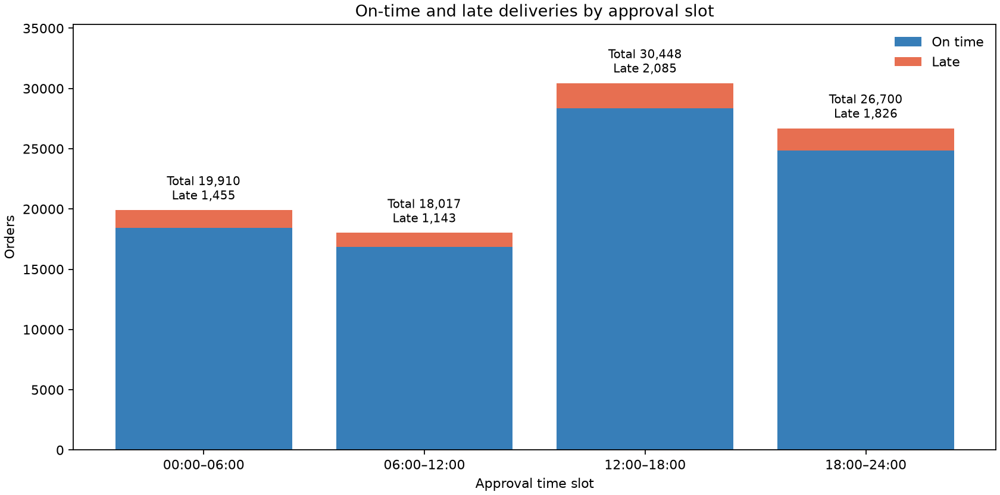

*Figure 1. Each column counts on-time and late orders within one slot. Labels show the total and the number late.*

**12:00–18:00 has the most late orders**, accounting for **32.03%** of all late deliveries. **00:00–06:00 has the highest late rate**. The afternoon has **630 more late orders**, while the overnight rate is **0.46 percentage points** higher using unrounded values.

#### Approval hour, weekday and delay duration

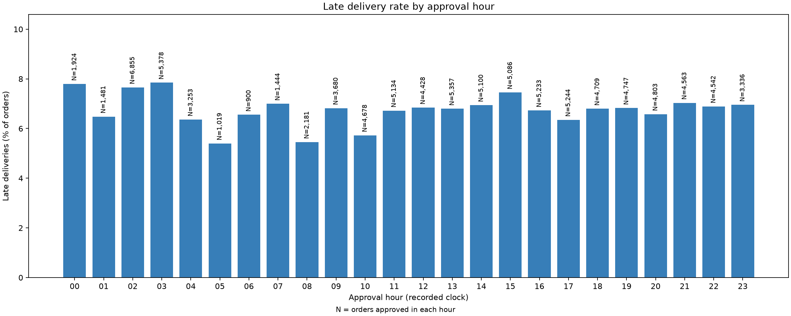

*Figure 2. Each hourly rate uses that hour's orders as its denominator. N is the number of orders.*

The highest hourly late rate is **422/5,378 orders (7.85%)** at 03:00–03:59. The busiest approval hour, 02:00–02:59, has **6,855 orders**, including **525 late (7.66%)**.

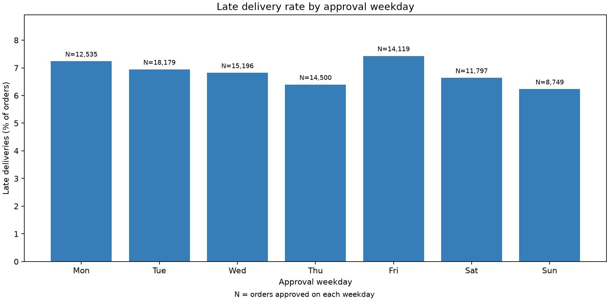

*Figure 3. Each weekday denominator includes all orders approved on that day across all hours.*

Friday has the highest weekday late rate, **1,049/14,119 (7.43%)**.

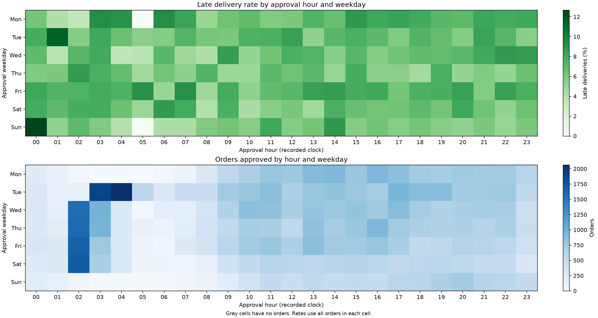

*Figure 4. Green shows late rates and blue shows order counts for the same hour × weekday cells. Grey indicates no orders.*

Sunday 00:00–00:59 has the highest observed hour × weekday rate, **30/237 orders (12.66%)**. Each cell's rate should be read with its denominator.

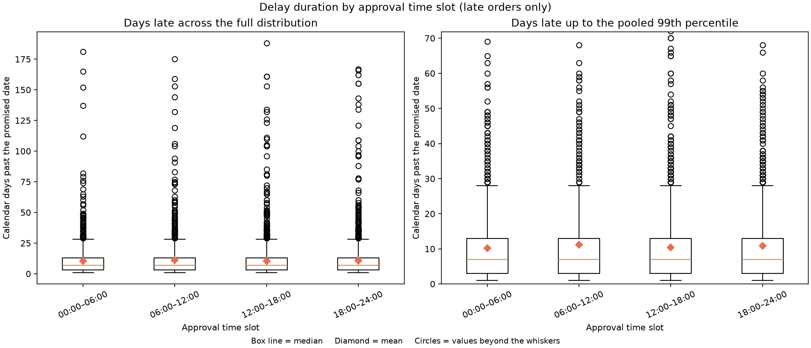

*Figure 5. Late orders only. The right panel limits the view to the overall 99th percentile; both panels calculate statistics from the full late-order samples.*

The median is **7 days** in every slot; means range from **10.25 to 11.18 days** among late orders.

The four-slot Chi-square test gives **13.78**, three degrees of freedom and **p = 0.0032**. At the 5% level, the overall test indicates that late rates differ across the four slots, while **Cramér’s V = 0.012** indicates a small association. The highest and lowest observed rates differ by **0.96 percentage points**. Separate comparisons are needed to identify individual pairs of slots that differ. The independence assumption warrants consideration because orders may share sellers or dates.

#### Purchase month and cohort coverage

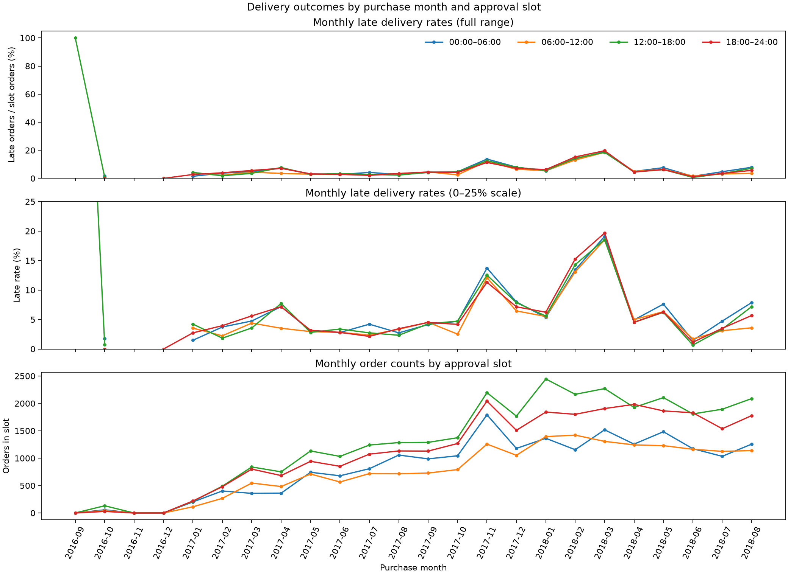

*Figure 6. Months use purchase dates and colors identify approval slots. The rate panels use two viewing scales; the final panel shows order counts by month × slot.*

September 2016 contains one order, November 2016 contains none, and August 2018 contains **6,261 orders** purchased through 29 August. Sample size and coverage affect the interpretation of each monthly point.

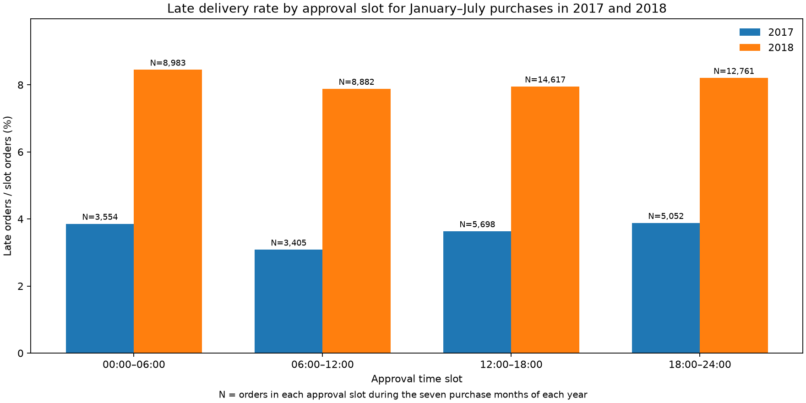

*Figure 7. The same January–July purchase months are compared across years. N is the number of orders in each year × slot group.*

Late rates in all four slots are higher in January–July 2018 than in the same months of 2017. Overnight approvals rise from **137/3,554 (3.85%)** to **759/8,983 (8.45%)**, while afternoon approvals rise from **207/5,698 (3.63%)** to **1,162/14,617 (7.95%)**.

The comparison of delivered orders with the required fields before cleaning and the cleaned cohort includes **96,456** and **95,075 orders**, respectively. Afternoon late counts are **2,100 and 2,085**. Overnight remains the highest-rate slot, rounded to **7.31%** in both cohorts.

#### Delivery stages and route types

Delivery time is divided into **approval → carrier handoff** and **handoff → customer delivery**. Calendar hours measure the full elapsed interval. Eligible-day hours count Monday–Friday except 1 January, 1 May and 25 December, with up to 24 hours per eligible day. This convention does not measure actual staffed hours.

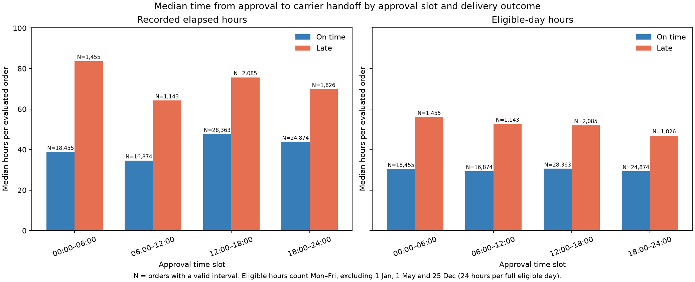

*Figure 8. Median by slot and observed delivery outcome. N is the number of orders with a valid interval. The panels use calendar hours and eligible-day hours.*

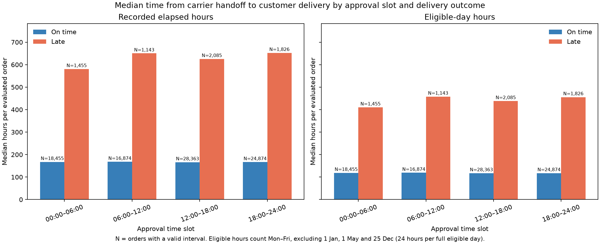

*Figure 9. Median by slot and observed delivery outcome. N is the number of valid intervals.*

Across all slots, median approval-to-handoff time is **43.01 calendar hours** for on-time orders and **73.60 hours** for late orders. Median handoff-to-delivery time is **166.95 and 628.75 hours**, respectively. All **95,075 orders** have valid intervals for both stages. The outcome split is retrospective.

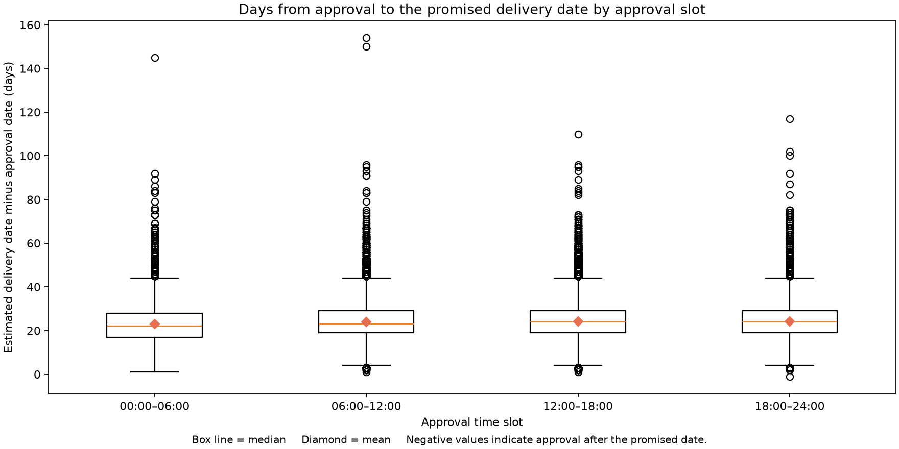

*Figure 10. The promised window is measured in calendar days. A negative value means approval occurred after the promised date.*

Median days from approval to the promised date are **22, 23, 24 and 24** across the four slots in order. One order has a negative window and remains available for review.

For an **intra-state** order, each item's seller and customer states match. An **inter-state** order has different seller and customer states for every item. A **mixed** order contains both patterns; a missing state makes the route unknown.

| Route type | Orders | Late orders | Late rate |
|---|---:|---:|---:|
| Intra-state | 34,059 | 1,558 | 4.57% |
| Inter-state | 60,776 | 4,950 | 8.14% |
| Mixed | 240 | 1 | 0.42% |
| Unknown | 0 | 0 | Undefined |

Inter-state orders account for **63.92% of orders** and **76.05% of late deliveries**. Their late rate exceeds the intra-state rate by **3.57 percentage points**.

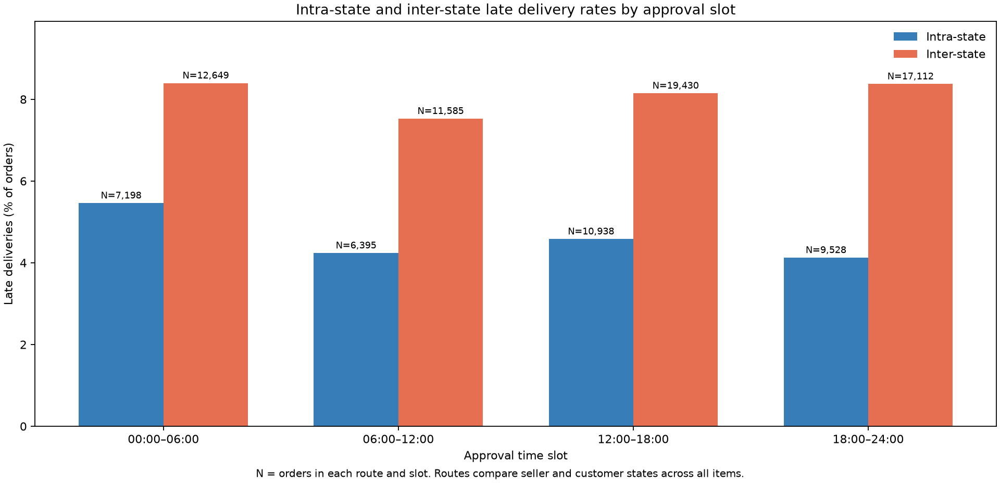

*Figure 11. N and the late rate use the orders in each route × slot group.*

Within intra-state orders, 00:00–06:00 has the highest late rate at **393/7,198 (5.46%)**. Among inter-state orders its rate is **1,062/12,649 (8.40%)**, close to **8.37%** for 18:00–24:00.

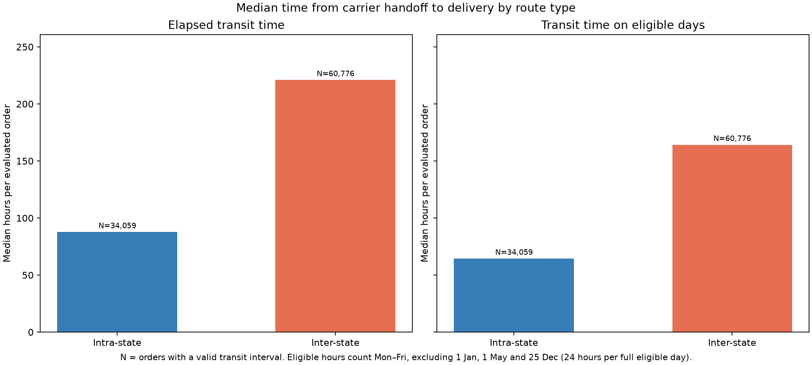

*Figure 12. Median handoff-to-delivery time; N is the number of valid intervals within each route.*

Median handoff-to-delivery time is **87.77 calendar hours** for intra-state orders and **221.04 hours** for inter-state orders. Seller and customer states are a geographic proxy and do not measure actual distance.

### Orders approved from 12:00–18:00

The afternoon cohort contains **30,448 orders and 2,085 late deliveries (6.85%)**. It includes **19,430 inter-state orders**, of which **1,583 were late (8.15%)**, and **501/10,938 intra-state orders late (4.58%)**. Inter-state orders account for **63.81% of orders** but **75.92% of late deliveries** in the slot.

#### Customer states and state pairs

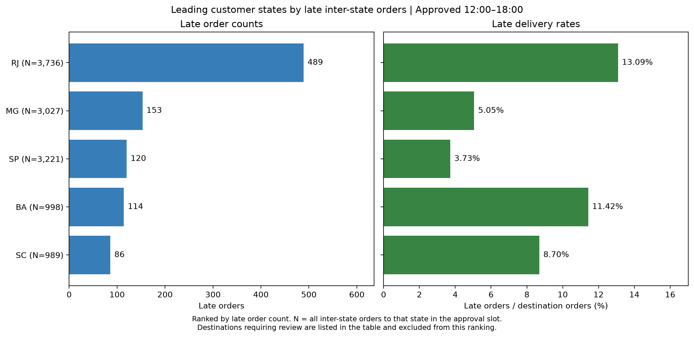

*Figure 13. States are ranked by late order count. N is the number of inter-state orders to each state approved in the afternoon.*

Across all routes, SP has the most late deliveries, **580/12,999 (4.46%)**. Among inter-state orders, RJ leads with **489/3,736 (13.09%)**, accounting for **30.89%** of the 1,583 late inter-state orders. CE has fewer late deliveries than RJ but a higher rate, **68/412 (16.50%)**.

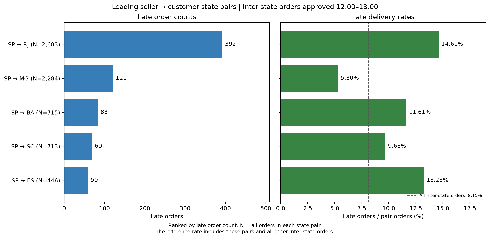

*Figure 14. Pairs are ranked by late count; N is the pair's order count. The reference line uses all inter-state orders in the slot, including the displayed pairs.*

Of 19,430 inter-state orders, **19,354** have one identifiable seller state. The remaining **76** involve sellers in multiple states, arrived on time and remain in the inter-state total. Pairs are shown as seller state → customer state.

SP → RJ has **392/2,683 late orders (14.61%)**, representing **392/489 (80.16%)** of late inter-state deliveries to RJ. Other inter-state orders to RJ have **97/1,053 late (9.21%)**. SP → MG has a similar order volume but a lower late rate, **121/2,284 (5.30%)**.

#### Purchase month, approval hour and weekday

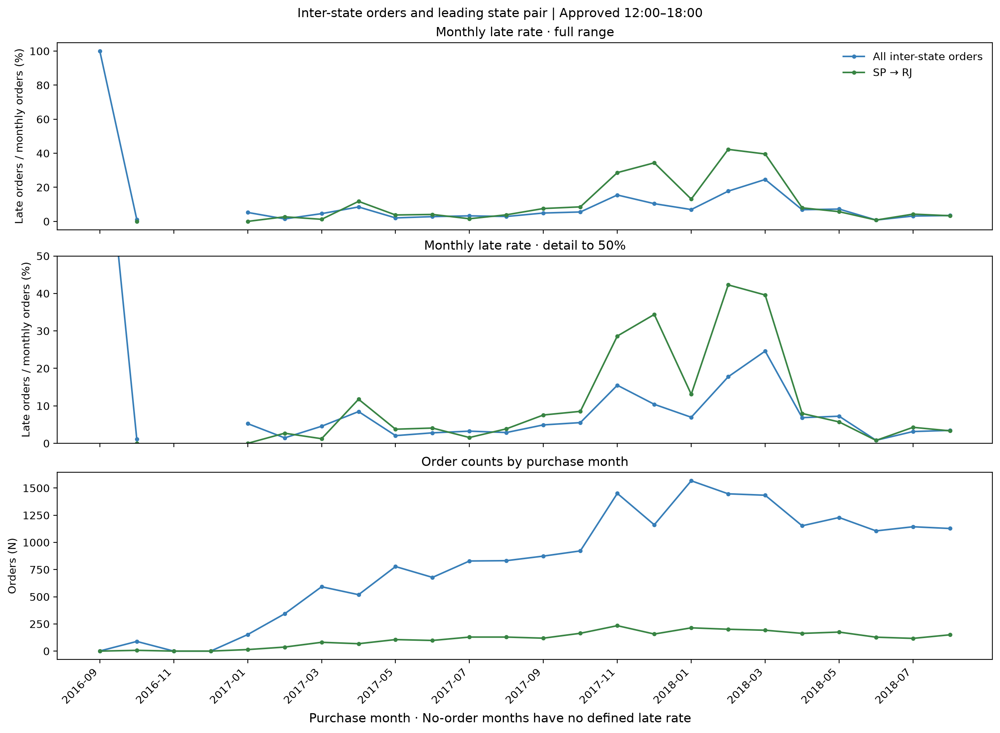

*Figure 15. Months use purchase dates; the cohort is selected by approval time. Rate panels use two scales and the final panel shows order counts.*

On SP → RJ, November–December 2017 and February–March 2018 contain **784/2,683 orders (29.22%)** but **282/392 late deliveries (71.94%)** on the route. These 282 cases account for **13.53%** of all afternoon late deliveries.

| Purchase period | SP → RJ, late / total | All remaining inter-state, late / total |
|---|---:|---:|
| Nov–Dec 2017 | 121/391 — 30.95% | 225/2,222 — 10.13% |
| Feb–Mar 2018 | 161/393 — 40.97% | 449/2,488 — 18.05% |
| Apr–Jul 2018 | 29/583 — 4.97% | 184/4,049 — 4.54% |

Remaining inter-state orders include all destinations after excluding SP → RJ. In matched January–July purchase months, SP → RJ has **20/533 late (3.75%)** in 2017 and **218/1,190 (18.32%)** in 2018.

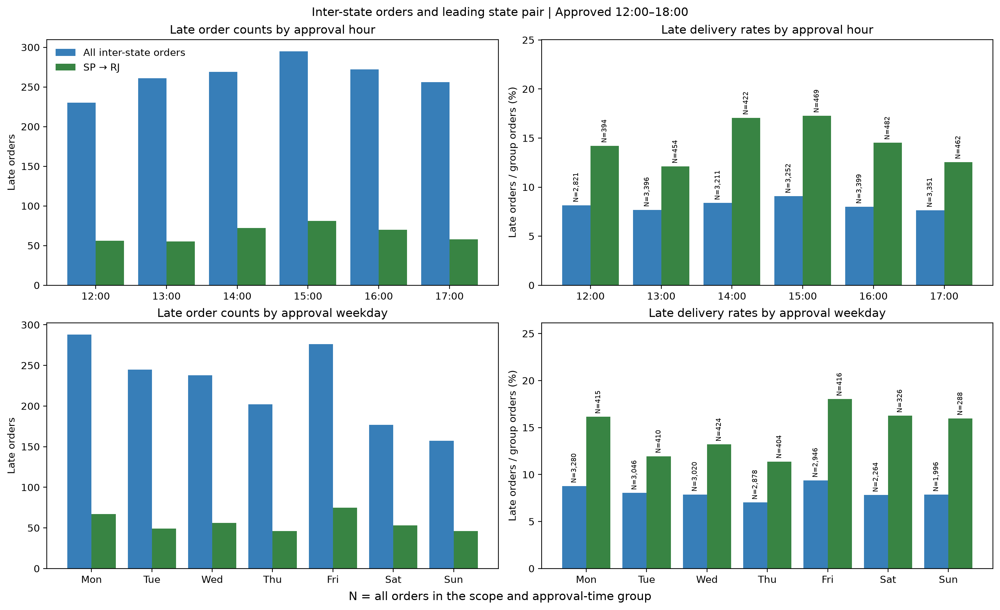

*Figure 16. Hours and weekdays are separate groupings. N is the number of orders in each group.*

On SP → RJ, 15:00–15:59 has the most late deliveries, **81/469 (17.27%)**, compared with **72/422 (17.06%)** at 14:00–14:59. Friday leads the weekday grouping in both count and rate, with **75/416 (18.03%)**.

### SP → RJ across four approval slots

SP → RJ is selected from afternoon approvals, then retrieved across **all four slots**, yielding **8,034 orders**.

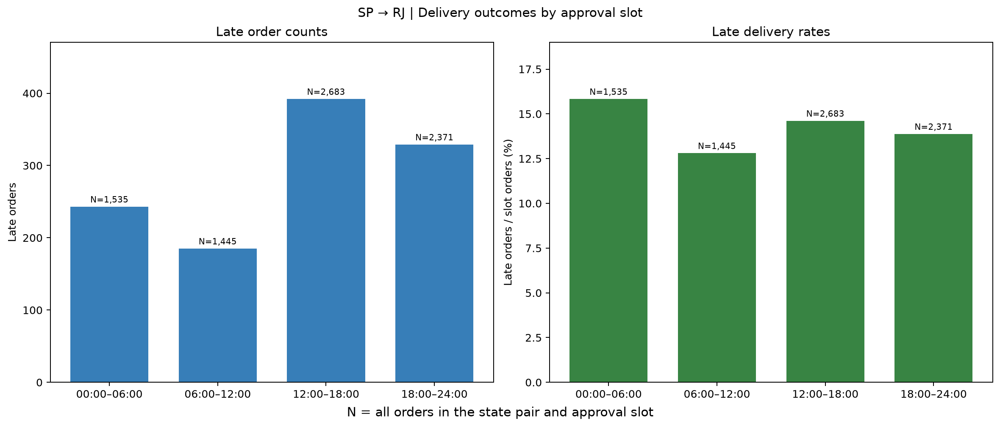

*Figure 17. N is the pair's order count in each slot.*

| Approval slot | Late / total | Raw rate | Purchase-month standardized rate |
|---|---:|---:|---:|
| 00:00–06:00 | 243/1,535 | 15.83% | 15.72% |
| 06:00–12:00 | 185/1,445 | 12.80% | 13.05% |
| 12:00–18:00 | 392/2,683 | 14.61% | 14.52% |
| 18:00–24:00 | 329/2,371 | 13.88% | 14.05% |

The afternoon has the most late orders on the route; overnight has the highest rate. Their respective 95% Wilson intervals are **13.32–16.00%** and **14.09–17.74%**. Standardized rates use common monthly weights for all four slots.

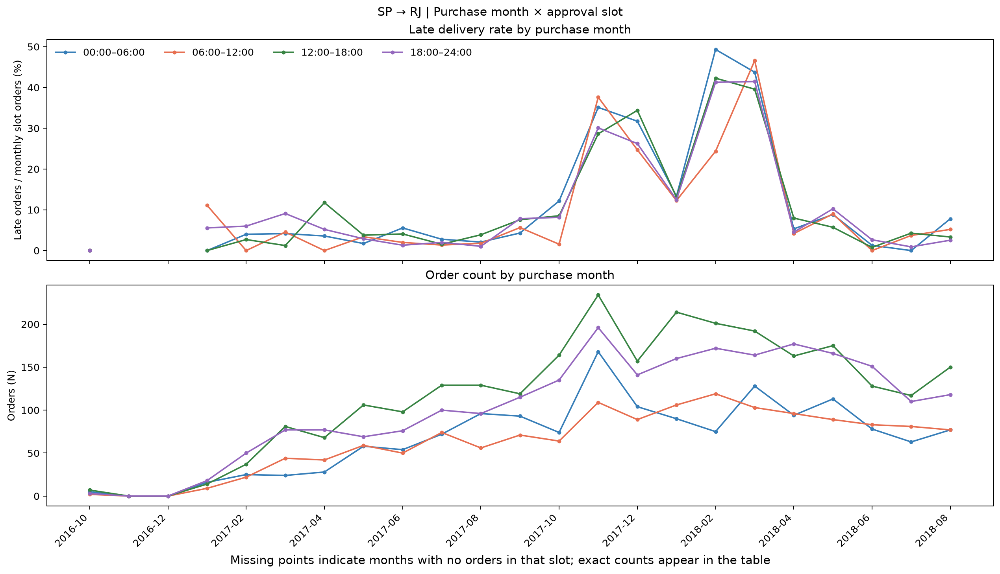

*Figure 18. Colors identify approval slots and the horizontal axis uses purchase months. Rates are undefined for months without orders.*

Across **21 months represented in all four slots**, the standardized overnight and afternoon rates are **15.72%** and **14.52%**. Removing the first and last observed months leaves **19 months** and preserves the ordering. Across all slots, **November 2017 has 226/707 late (31.97%)** and **February 2018 has 222/567 late (39.15%)**. Observed order volume does not directly measure operational workload.

#### Delivery stages and promised windows by period

The comparison group is **other inter-state orders to RJ** in the same purchase period and approval slot. This differs from all remaining inter-state orders in the afternoon purchase-month comparison.

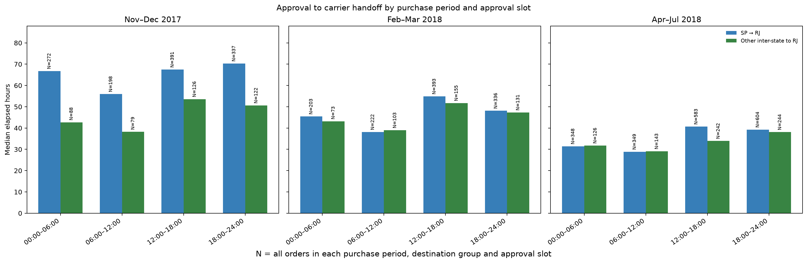

*Figure 19. Median calendar hours by purchase period, group and slot. N is the cell's total orders; valid interval counts are in the notebook.*

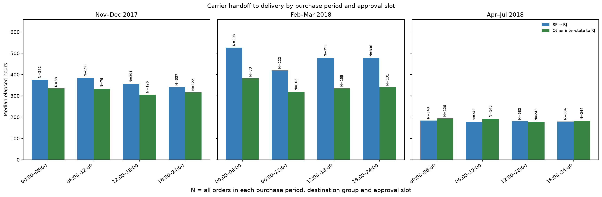

*Figure 20. Median calendar hours; N is the cell's total orders. Transit duration is distinct from time past the promised date.*

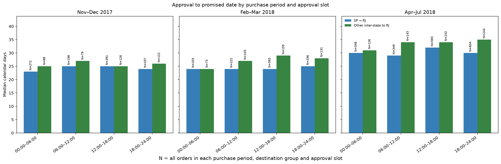

*Figure 21. Promised windows use calendar days. N is the cell's total orders.*

For afternoon SP → RJ approvals, the late rate rises from **30.95% to 40.97%** between November–December 2017 and February–March 2018, while the approval-to-handoff median falls from **67.44 to 54.85 calendar hours**. In February–March, median handoff-to-delivery time is **477.88 hours** for SP → RJ and **335.43 hours** for the comparator. P75 is **715.94 and 626.68 hours**, and median promised windows are **24 and 29 days**, respectively.

In April–July 2018, SP → RJ's afternoon late rate falls to **4.97%**, median transit to **180.18 hours**, while the median promised window rises to **32 days**. These medians describe co-occurring changes and do not apportion their contributions. Stage medians cannot be added to obtain the median end-to-end journey.

In February–March 2018, the **161 late SP → RJ orders** have a median transit of **764.89 hours**, compared with **306.74 hours** for 232 on-time orders. The comparator has **35 late orders**, with a median of **796.54 hours**. These outcome-specific groups differ from the full cohorts.

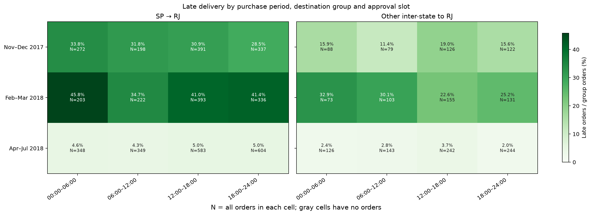

*Figure 22. Both panels use the same green color scale. Each cell gives its rate and total orders N; grey indicates no orders.*

Both groups' late rates rise from November–December 2017 to February–March 2018 and fall by April–July 2018 in all four slots. The afternoon SP → RJ minus comparator differences are **11.90, 18.39 and 1.26 percentage points**, respectively.

### Orders approved from 00:00–06:00

The overnight cohort has **19,910 orders**, including **1,455 late deliveries (7.31%)**. All four route types remain in scope.

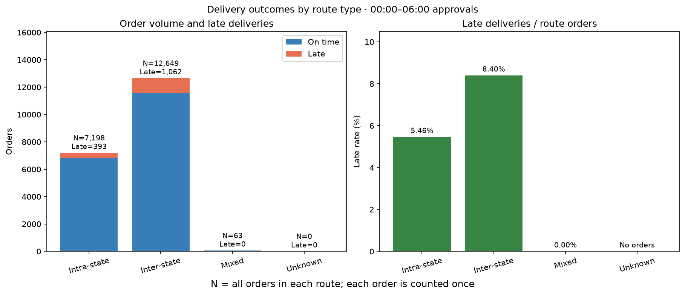

*Figure 23. N is the order count for each route type and is the denominator for its late rate. Empty groups have undefined rates.*

Inter-state orders account for **12,649/19,910 orders (63.53%)** and **1,062/1,455 late deliveries (72.99%)**. Late rates are **8.40%** inter-state and **5.46%** intra-state. All **63 mixed orders** arrived on time; none have an unknown route.

Across all route types, SP has the most late deliveries, **452/8,365 (5.40%)**. RJ has **309/2,283 (13.53%)**. Among inter-state orders, RJ leads with **300/2,129 (14.09%)**.

A single seller state is identifiable for **19,792 orders**, including **1,454 late deliveries**. Another **118 orders** involve sellers in multiple states, including one late delivery. They remain in slot totals and are separate from individual state pairs.

### Comparing the two approval slots

The analysis compares **00:00–06:00 and 12:00–18:00** using the same customer-state or seller-to-customer state-pair definitions. Wilson 95% intervals describe rate uncertainty under the assumption of independent orders.

#### Destinations and state pairs

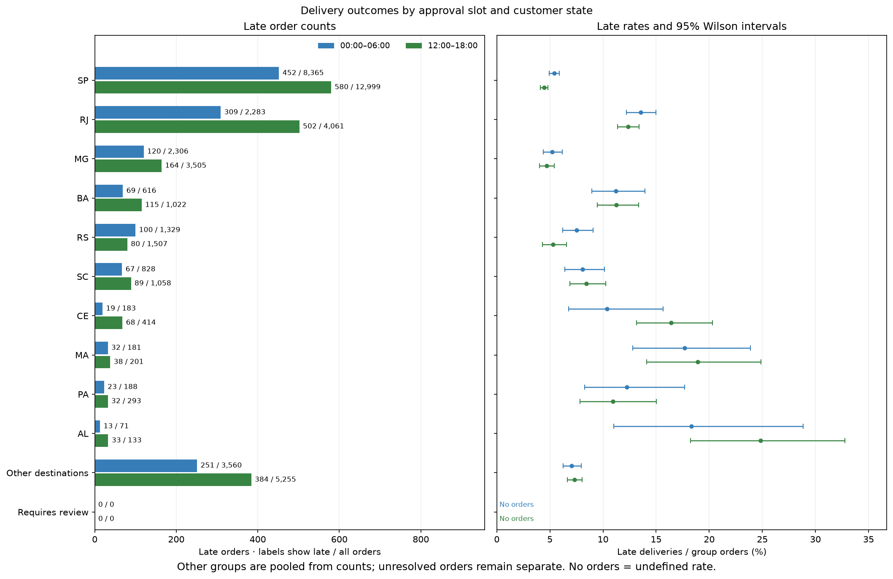

*Figure 24. States are selected by late count, rate or difference between slots. Left labels show late / total; the right panel shows rates and 95% Wilson intervals.*

The overnight rate is not higher in every state. CE has **19/183 (10.38%)** overnight versus **68/414 (16.43%)** in the afternoon, a **−6.04 percentage-point** gap. Groups are selected for exploration using count, rate or difference; the 100-order threshold is a screening convention.

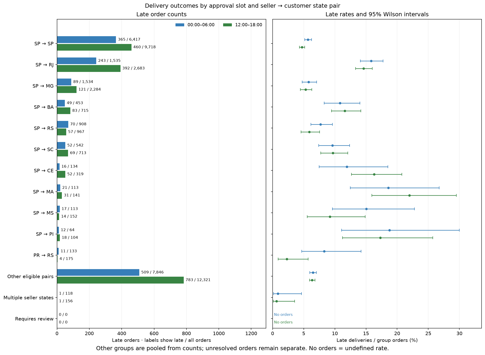

*Figure 25. Pairs are seller state → customer state. Unselected pairs are pooled using counts; multiple seller-state and review groups remain separate.*

SP → SP has **365/6,417 late (5.69%)** overnight and **460/9,718 (4.73%)** in the afternoon. SP → RJ has **243/1,535 (15.83%)** and **392/2,683 (14.61%)**, respectively. PR → RS has the largest raw gap among pairs with at least 100 orders in each slot, but its late counts are **11/133** and **4/175**.

The pairs selected for the figure contain **945/1,455 overnight late deliveries (64.95%)**. The remaining eligible pairs contain **509**, and the multiple seller-state group contains **one**. SP → SP and SP → RJ contain **608 late deliveries (41.79%)** over the full period, leaving **847** in other groups. The routes contain distinct orders.

#### Purchase months

Purchase dates define months; approval times define the cohorts. Monthly series and order counts show variation across periods and small samples.

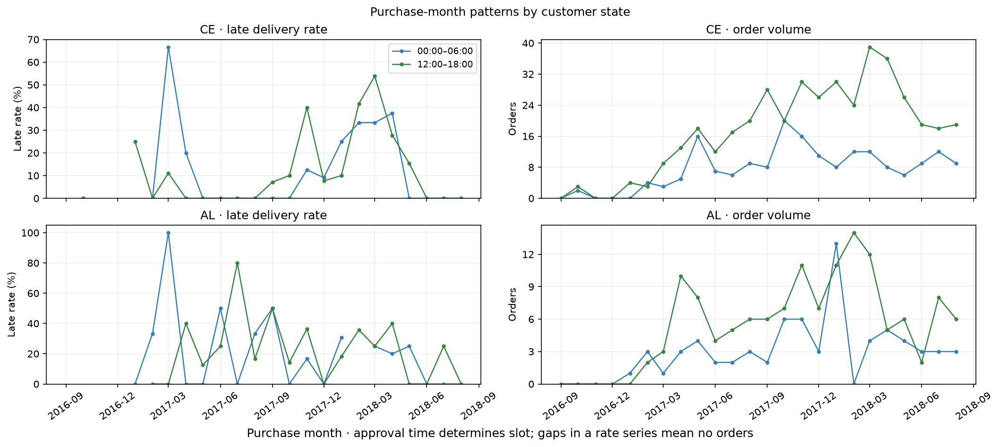

*Figure 26. Late rates by purchase month appear on the left and order counts on the right. A gap in a rate series indicates no orders for that slot and month.*

In March 2017, **2/3** overnight CE orders were late; AL has **1/1**. CE's overnight minus afternoon gap is **−6.04 percentage points** over the full period, **−5.96 points** in the 20 shared months, and **−2.84 points** after standardization. Four afternoon orders, including one late delivery, lie outside shared months.

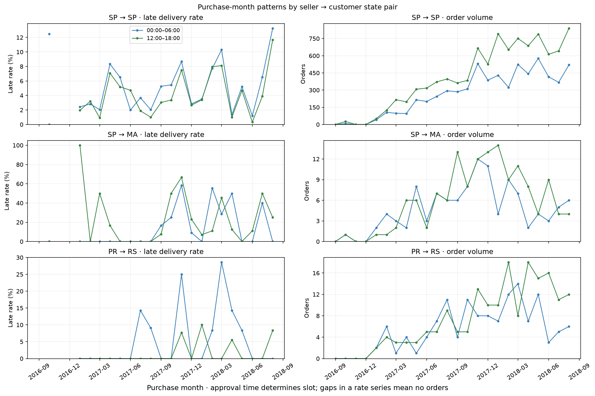

*Figure 27. SP → SP, SP → MA and PR → RS are shown by purchase month and approval slot. The notebook contains the full SP → RJ monthly table, and Figure 18 displays all four slots for that route.*

SP → SP has a higher overnight rate in **18/21 shared months**. August 2018 has the route's largest monthly late counts in both slots: **69/520 (13.27%)** overnight and **98/840 (11.67%)** in the afternoon. These are **18.90%** and **21.30%** of the route's full-period late counts in their respective slots. August is the final observed purchase month.

For SP → RJ, November–December 2017 and February–March 2018 contain **185/243 overnight late deliveries (76.13%)** and **282/392 afternoon late deliveries (71.94%)** on the route. These represent **12.71%** and **13.53%** of all late deliveries in their respective slots.

Two-slot standardization uses months with orders in both slots and weights based on their combined counts in each shared month. SP → SP has standardized rates of **5.71% versus 4.71%**, a **+1.00 percentage-point** gap. SP → RJ has **15.89% versus 14.62%**, a **+1.27-point** gap. Each calculation uses **21 shared months** for that route. The two-slot weights differ from the four-slot weights in the four-slot comparison.

#### Delivery stages and promised windows

SP → RJ is compared with **other inter-state orders to RJ** in the same purchase period and approval slot. The three stage-analysis periods contain **823/1,535 overnight orders**, including **201/243 late deliveries** on SP → RJ. The afternoon coverage is **1,367/2,683 orders** and **311/392 late deliveries**.

| Feb–Mar 2018 purchases, all orders in group | Late / total | Late rate | Median after handoff | P75 after handoff | Median promised window |
|---|---:|---:|---:|---:|---:|
| SP → RJ, overnight | 93/203 | 45.81% | 526.61 hours | 849.51 hours | 24 days |
| SP → RJ, afternoon | 161/393 | 40.97% | 477.88 hours | 715.94 hours | 24 days |
| Other inter-state to RJ, overnight | 24/73 | 32.88% | 382.25 hours | 672.00 hours | 24 days |
| Other inter-state to RJ, afternoon | 35/155 | 22.58% | 335.43 hours | 626.68 hours | 29 days |

Durations in the table are calendar hours. Both overnight groups have a **24-day** median promised window. In the afternoon, the respective medians are **24 and 29 days**. Median eligible-day hours after handoff are **382.61** for overnight SP → RJ and **270.08** for its comparator. From November–December 2017 to February–March 2018, overnight SP → RJ's pre-handoff median falls from **66.77 to 45.41 hours**, while its late rate rises.

Among late deliveries alone in February–March 2018, median time after handoff is **891.75 hours** for **93 overnight SP → RJ orders** and **854.75 hours** for the **24 late comparator orders**. This retrospective split has different denominators from the full-cohort table.

SP → SP is examined within the route over its 21 shared months. Stage tables pool all orders within each slot without monthly weights.

| All SP → SP orders in shared months | Overnight | Afternoon |
|---|---:|---:|
| Orders / valid intervals for each stage | 6,417 / 6,417 | 9,718 / 9,718 |
| Median approval → handoff, calendar hours | 39.53 | 47.73 |
| Median handoff → delivery, calendar hours | 89.71 | 83.67 |
| P75 handoff → delivery, calendar hours | 147.06 | 146.61 |
| Median handoff → delivery, eligible-day hours | 65.16 | 61.83 |
| Median promised window, calendar days | 16 | 17 |

The overnight transit median is **6.04 hours** higher, while P75 is similar. After splitting by observed delivery outcome, overnight/afternoon transit medians are **81.64/79.49 hours** for on-time orders and **294.41/300.43 hours** for late orders.

Of **1,455 overnight late deliveries**, the stage tables cover **365 SP → SP cases** and **201 SP → RJ cases in the three periods**, totaling **566 (38.90%)**. Including **41** other inter-state late deliveries to RJ gives **607 (41.72%)**. Cases outside the stage scope remain represented in the relevant overall, geographic or monthly tables.

## 4. Conclusions and limitations

Among delivered orders retained after cleaning, **12:00–18:00 has the most late deliveries, at 2,085**, while **00:00–06:00 has the highest late rate, 7.31%**. The slots use recorded approval time.

SP → SP is a substantial intra-state group whose overnight rate is higher than its afternoon rate across many months. SP → RJ has concentrated late deliveries in November–December 2017 and February–March 2018 in both slots. The routes and periods provide scopes for reviewing handoff, transit and promised-date records.

Routes and periods were selected after inspecting the data. Some groups are small, and observed order counts do not measure operating capacity. Matching on destination, purchase period or month weights does not control for all seller and within-month conditions. The results describe observed associations and do not establish the effect of changing approval times or the causal contribution of each stage.
